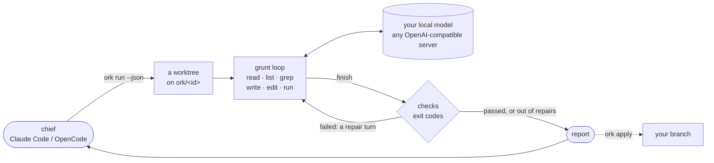

<p align="center">
  
</p>

<h1 align="center">orkestr8R</h1>

<p align="center">
  <b>Frontier plans. Local executes.</b><br>
  Claude Code or OpenCode hands real coding work to your own models. The work is run, checked and
  reported back, so you stop copy-pasting plans between them.
</p>

<p align="center">
  <a href="https://github.com/ivanwe2/orkestr8R/actions/workflows/ci.yml"></a>
  <a href="https://github.com/ivanwe2/orkestr8R/releases"></a>
  <a href="LICENSE"></a>
  
</p>

> [!NOTE]
> **Status: v0.1 is built and being tried on real work (November 2026).** The first release follows.
> The plan: [docs/vision.md](docs/vision.md) → [docs/iteration-1.md](docs/iteration-1.md) →
> [docs/plan-v0.1.md](docs/plan-v0.1.md).

## The idea

You have a frontier model (Claude Code, OpenCode on a cloud model) and a local one (llama.cpp,
llama-swap, Ollama, vLLM on your own GPUs). Today you're the middleman: you copy the plan, explain
it and hand it over. orkestr8R takes that job:

- the **chief** (your frontier session) writes an *order*: a goal, the files the work may touch,
  and the commands that prove it works;
- a **grunt** (orkestr8R's own agent loop on your local model) does the work in its own git
  worktree;
- orkestr8R runs the checks itself, gives the grunt a couple of tries to fix what fails, and hands the
  chief a short report: what changed, what passed, what's open. Nothing reaches your branch until
  it's applied.

The chief spends its tokens on judgment. Your GPUs do the volume.

## How it works



- The grunt acts only through its tools, inside the worktree: paths are checked, writes must match
  the order's scope, commands must be on the allow-list and run without a shell.
- `finish` doesn't end the job; the checks do. The model saying "done" counts for nothing.
- Guards catch the ways local models get stuck (text instead of tool calls, broken calls, the same
  call again), and old tool output is stubbed when the context fills up.
- Every model request and tool call is an event: tokens, seconds, tokens per second, exit codes.

What a run looks like, for people (an example; agents get the same as JSON Lines with `--json`):

```
ork run k7f2 · grunt qwen3-coder on box · .ork/worktrees/k7f2
  t1  read_file src/time.rs   ok  2ms   5.8k→96 tok  48 t/s
  t2  write_file tests/time.rs   ok  1ms   6.9k→612 tok  45 t/s
  t3  finish  Added 6 tests for parse_duration   7.6k→58 tok  50 t/s
  ✗ cargo test --test time  exit 101  9.4s
  repair 1
  t4  edit_file tests/time.rs   ok  1ms   8.3k→140 tok  47 t/s
  t5  finish  Fixed the expected value for "90s"   8.5k→41 tok  51 t/s
  ✓ cargo test --test time  8.1s
passed · 5 turns · 1 repair · 37.1k in / 947 out
```

## Quickstart

You need git, an OpenAI-compatible server for your local model (llama-server, llama-swap, Ollama,
vLLM, LM Studio), and either Rust or a release binary.

1. **Install.** Download `ork` from the [releases](https://github.com/ivanwe2/orkestr8R/releases)
   and put it on your PATH, or build it from a clone: `cargo install --path . --locked`.
2. **Point it at your model**, in the repo you want to work on:
   ```
   ork init --url http://localhost:8080/v1 --model <model name>
   ```
   That writes `ork.json` (the server, the grunt's model, and the build and test commands it may
   run, detected from `Cargo.toml`, `go.mod`, `*.csproj` or `package.json`) and keeps `.ork/` out of
   git. If the server needs an API key, put the server in your own config instead:
   `ork init --user --url … --model … --key-env <VARIABLE>` (the key itself stays in that variable).
3. **Check.** `ork doctor`: all ✓ means the server answers, the model calls tools, and the allowed
   commands are on PATH.
4. **Run an order.**
   ```
   ork run --goal "Add tests for parse_duration in src/time.rs" \
     --path src/time.rs --scope "src/time.rs" --scope "tests/**" \
     --check "cargo test --test time"
   ```
5. **Land it.** `ork diff k7f2` to look, then `ork apply k7f2` (or `ork discard k7f2`).

**For Claude Code:** `cp -r skills/orkestr8r ~/.claude/skills/`. It then knows when to delegate, and
runs `ork guide` for the details (`--json`, long runs, reading the report).

## Commands

| | |
|---|---|
| `ork init` | write `ork.json`: the server, the model, the allowed commands |
| `ork doctor` | is everything in place? config, git, server, tool calling, commands |
| `ork models [--test]` | which model does each role, on which server; how fast |
| `ork ask "…" --path FILE` | a quick read-only answer about files |
| `ork run …` | run one order: worktree, grunt loop, checks, report |
| `ork jobs` · `ork status JOB` | every job; one job |
| `ork diff JOB` · `ork logs JOB` | the changes; the whole conversation with the model |
| `ork apply JOB` · `ork discard JOB` | merge it into your branch; drop it |
| `ork guide` | the guide for AI agents |
| `ork tui` | a live view: jobs, tokens, speed and cost per model (local or cloud); diff and apply on keys |

Every command but `ork tui` takes `--json`: one event per line on stdout, the last one always `result`; exit codes
0 done, 1 error, 4 checks failed or gave up. The contract is [docs/cli.md](docs/cli.md).

## Safety, briefly

Every job runs in its own worktree, paths are guarded, commands are allow-listed and get a scrubbed
environment, and API keys only go to servers your own config names. But the allow-list isn't a
sandbox: checks run code the grunt wrote. Use orkestr8R on code whose tests you'd run yourself.
Details, and how to report a problem: [SECURITY.md](SECURITY.md).

## Docs

| | |
|---|---|
| [docs/vision.md](docs/vision.md) | why, principles, vocabulary, what's borrowed from localdub, roadmap |
| [docs/iteration-1.md](docs/iteration-1.md) | the first build: scope, architecture, milestones M0–M5 |
| [docs/plan-v0.1.md](docs/plan-v0.1.md) | v0.1 task by task (T01–T16): contracts, files, acceptance commands, for people and agents |
| [docs/cli.md](docs/cli.md) | the `ork` CLI and MCP contract: commands, orders, reports, events, exit codes |
| [docs/agent-loop.md](docs/agent-loop.md) | what an agent loop is, one turn on the wire, how the grunt's loop works, a learning path |
| [docs/swarm.md](docs/swarm.md) | where it goes next: tiers, plans, parallel grunts, verifiers, merge queue |
| [docs/landscape.md](docs/landscape.md) | what already exists, what's current (Nov 2026), and what we take from it |
| [docs/decisions.md](docs/decisions.md) | decisions so far, open questions |
| [docs/brand.md](docs/brand.md) | logo, colours, type |

## Stack

Rust: one binary, `ork`, with tokio, reqwest and serde, and no LLM SDK or agent framework (the loop
is ours, and the wire JSON stays visible). Next: MCP with the official Rust SDK (`rmcp`, v0.2) and a
web UI in React + TypeScript (iteration 2).

## Contributing

See [CONTRIBUTING.md](CONTRIBUTING.md): build and test, conventions, and the notes agents work from
([AGENTS.md](AGENTS.md)).

## License

MIT, see [LICENSE](LICENSE).
