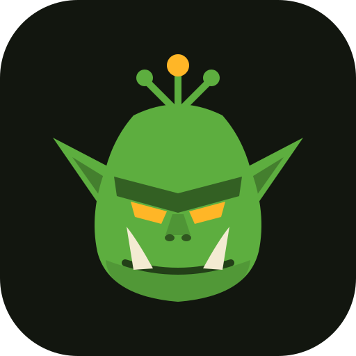

# Brand

  

## The mark

An original orc head:
- pointed ears and tusks;
- amber eyes under a heavy brow;
- a topknot drawn as a small graph: **one amber node (the chief) above two green nodes (the
  grunts)**. The product in one glyph: one model gives orders, others do the work.

Keep it original: no look or detail from existing games' orcs.

Files:
- `assets/logo/mark.svg`: the mark alone, on a transparent background.
- `assets/logo/icon.svg`: the app icon (dark rounded square).

The working canvas, with a social preview card (1280×640), the app icon and a light README banner,
is a Claude design artifact (private to Ivan):
https://claude.ai/artifact/4SpvLGrmnQpdFt2HSSwPc4

## Colours

| Token | Hex | Use |
|---|---|---|
| skin | `#5DAE3F` | the orc, "ork" in the wordmark on dark |
| skin, dark | `#3F7F2A` | "ork" on light backgrounds |
| accent | `#FFB627` | eyes, the chief node, "8" on dark |
| accent, dark | `#A86400` | "8" on light backgrounds |
| ground | `#12160F` | dark background |
| paper | `#F4F1E8` | light background |
| tusk | `#F3EBD2` | tusks |
| text, muted | `#A9B3A0` (dark) / `#4A5244` (light) | taglines |

## Type

- **Wordmark:** Bricolage Grotesque 800, tight tracking (−0.03em). Written `orkestr8R`, with "ork" in
  skin green and "8" in accent.
- **Taglines and code:** JetBrains Mono 500.

## Words

- Tagline: **frontier plans · local executes**
- One line: an MCP-native harness for frontier + local models; open source, self-hosted.
