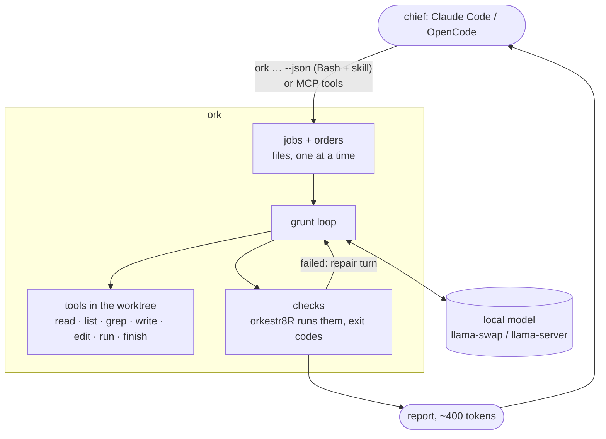

# Iteration 1: one grunt, one repo

Drafted 2026-11-23. The goal: the chief writes an order, a local grunt does it in a worktree,
orkestr8R checks it and reports back, and nobody copy-pastes anything.

## Scope

**In**
- Coding tasks, one repo at a time.
- One model role, `grunt`, on any OpenAI-compatible server (llama-swap, llama-server, Ollama, vLLM,
  LM Studio). OpenRouter works too since it's the same API, but presets come in iteration 2.
- The `ork` CLI with `--json` and exit codes (docs/cli.md); `ork mcp` over stdio.
- The grunt loop with file and shell tools in a git worktree (docs/agent-loop.md).
- Checks run by orkestr8R, plus a bounded repair loop.
- Jobs as files under `.ork/jobs/`: state, events and transcripts (JSON and JSONL).
- `ork guide`, `skills/orkestr8r/SKILL.md`, and `ork init` writing the delegation rules.

**Out, for later**
- Web UI, daemon and notifications (iteration 2).
- Several grunts at once, model tiers, plans, verifiers (iteration 3, docs/swarm.md).
- Non-coding tasks and grunts on other machines (iteration 4).
- Auto-merge.

## Architecture



- `ork mcp` runs the jobs in-process: a background tokio task fed by a channel, one job at a time.
  Simple, but jobs end when the chief's session closes. Iteration 2's `ork serve` fixes that.
- Every job: worktree `.ork/worktrees/<id>` on branch `ork/<id>`, from the current HEAD.
- Every job writes `.ork/jobs/<id>/events.jsonl` (the same events `--json` prints) and
  `transcript.jsonl` (every message sent to and from the model). The chief never reads these unless
  something needs debugging.

## Two ways in for the chief

1. **CLI + skill (default).** Claude Code and OpenCode both run shell commands. The skill teaches them
   `ork run --json`, so no tool schemas sit in their context until the skill is needed. Agent Skills
   load only a name and description (about 100 tokens) at startup.
2. **MCP.** Same commands as tools (docs/cli.md). Use it for clients without a shell, or to get MCP
   Tasks (long calls running in the background) in Claude Code.

## The grunt loop

Spelled out in docs/agent-loop.md. In short:

- **Prompt.** The system prompt, then the order. Seed context: the `paths` files (capped), a depth-2
  tree of the repo, and the checks.
- **Turns.** Call the model with tools at temperature 0.1–0.2, strip `<think>` blocks, validate
  arguments, run the tool, truncate the output (head + tail, ~4k chars) and append it.
- **Stops.** `finish`, `max_turns`, the token budget, wall-clock time, or repeated malformed calls
  (`gave_up`).
- **On `finish`.** orkestr8R runs the checks. On failure the output goes back as a repair turn, up to
  `max_repairs`.
- **Context pressure.** Old tool outputs become one-line stubs; the calls themselves stay.

### Tools

| Tool | What |
|---|---|
| `read_file(path, start?, end?)` | numbered lines, up to 400 |
| `list_dir(path, depth?)` | the tree |
| `grep(pattern, path?, glob?)` | ripgrep when installed |
| `write_file(path, content)` | only inside `write_scope` |
| `edit_file(path, old, new)` | `old` must match exactly once |
| `run(cmd)` | allow-listed commands only, in the worktree, with a timeout and a scrubbed environment |
| `finish(summary, open_questions[])` | ends the attempt; orkestr8R checks it |

### Safety

- The grunt never touches your checkout; changes land only with `ork apply`.
- A path guard resolves every path and refuses anything outside the worktree or outside
  `write_scope`.
- Commands come from `allow_commands`. Secrets are dropped from the environment.
- Linux sandboxing with bubblewrap: iteration 1.1.

## Config

`ork.json` in the repo, or `~/.config/orkestr8r/ork.json`, with only the keys that differ from the
defaults. `ork init` writes it; `ork models` changes it.

```json
{
  "servers": {
    "box": { "url": "http://gpu-box:9876/v1", "key_env": "LLAMA_API_KEY" }
  },
  "roles": {
    "grunt": { "server": "box", "model": "YOUR-LLAMA-SWAP-MODEL", "context_tokens": 65536 }
  },
  "allow_commands": ["dotnet build", "dotnet test", "npm test", "npm run lint"],
  "defaults": { "max_turns": 40, "max_repairs": 2, "max_minutes": 20 }
}
```

## Stack

- Rust (decided 2026-11-24, see docs/decisions.md): one static binary `ork`, installed with
  `cargo install` or downloaded from a GitHub release. A Docker image comes in iteration 2.
- MCP: the official Rust SDK, `rmcp` 3.x, which implements MCP 2026-07-28 including long-running
  Tasks.
- Model calls: raw `reqwest` + `serde_json` against the OpenAI-compatible API. The loop is ours.
- tokio for async, processes and timeouts; clap for the CLI.
- Job state as files in v0.1; SQLite only if the v0.2 daemon needs it. Git through the `git`
  command (worktrees, diffs).

## Milestones

| | What | Done when |
|---|---|---|
| **M0** | Skeleton: solution, the fake model server for tests, `ork doctor` (server up, tool calling works, git ok), `ork ask`, `ork mcp` with `ork_ask` | `ork ask` answers about a file from Claude Code and from OpenCode |
| **M1** | The grunt loop, standalone: `ork run` with worktree, tools, finish, events, transcript. The learning milestone: built step by step (docs/agent-loop.md) | 5 hand-written orders on a real repo, run without a chief |
| **M2** | Checks, repair turns, the report, exit codes 0/3/4 | a failing test fixed in a repair turn, shown in the events |
| **M3** | Jobs: background jobs, `jobs/status/watch/diff/apply/discard`, the MCP tools, MCP Tasks | Claude Code delegates, keeps working, applies the result |
| **M4** | Agents use it on their own: `ork guide`, the skill, `ork init` (config, delegation rules for AGENTS.md / CLAUDE.md, MCP registration), the guide test | the chief delegates without being told to in the prompt |
| **M5** | Prove it: 10 real tasks with and without orkestr8R | numbers for chief tokens, grunt pass rate, repairs used, wall-clock time |

**Releases:**
- **v0.1** = M0 without MCP, plus M1, M2, and the guide and skill from M4. Task by task in
  **docs/plan-v0.1.md**.
- **v0.2** = M3 (MCP, background jobs, MCP Tasks) and the rest of M4.
- **v0.3** = M5.

**Iteration 1 is done** when, on a real feature, the chief writes a plan, delegates at least 3 orders,
at least 2 of them pass their checks without the chief rewriting them, and nothing was copy-pasted.

## Delegation rules (draft for AGENTS.md / CLAUDE.md, written by `ork init`)

- Delegate with `ork run` when the work is mechanical and checkable:
  - tests for existing code
  - boilerplate and CRUD
  - renames and multi-file refactors that follow a pattern
  - DTOs and mapping code
  - docs
- Use `ork ask` instead of reading a file over ~300 lines just to understand it.
- Don't delegate:
  - architecture decisions
  - unclear requirements
  - security-sensitive code
  - anything without a check command
- One goal per order, an explicit `write_scope`, and at least one check.
- Read the report. Look at the diff only if the status isn't `passed` or the change is risky. Then
  `ork apply`.

## Lessons taken from similar tools

- Frontier models hardly delegate unless told when to, so the rules ship with the tool.
- Delegating pays off when the chief doesn't have to read big files. On tiny tasks the tool call
  costs more than it saves.
- Strip `<think>` blocks. Keep grunt output terse.
- Judge by exit codes, never by the model's report.
- MCP calls in Claude Code move to the background after two minutes; MCP Tasks lets a call run long.
  Other clients poll with `ork_wait`.

Sources for all of these: docs/landscape.md.
