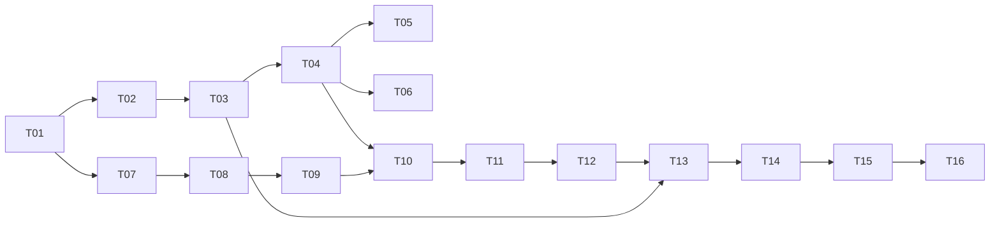

# Plan: v0.1

Drafted 2026-11-24. This is the build plan for the first release, written so that Claude Code, or
OpenCode on Ivan's local model, can pick up one task at a time and finish it without asking.

## How to work from this file (agents: read this first)

1. Read `AGENTS.md`, then this whole file once. The contracts below are shared by every task.
2. Take the **first task in Progress that isn't ticked and whose dependencies are ticked.** One task
   = one branch (named in the task) = one PR into `main`.
3. Build exactly what the task says. If something belongs to a later task or a later version, leave
   it. If the spec is wrong or unclear, fix the spec in this file in the same PR and say so in the
   PR description.
4. A task is done when every acceptance command passes, on Linux and Windows CI. Then tick it in
   Progress, in the same PR.
5. Tasks marked **explain** are the heart of the harness. Ivan wants to learn them, so explain each
   piece as it goes in: what it does, why it's there, and the C# idiom used. Keep it brief, as you
   go.
6. **Who:**
   - **any**: mechanical and fully specified; fine for a local model.
   - **frontier**: needs judgment; use Claude Code or another frontier model.

## Progress

- [ ] T01 Scaffold the solution
- [ ] T02 JSON, events and CLI output
- [ ] T03 Config and `ork init`
- [ ] T04 Model client and fake model server
- [ ] T05 `ork doctor` and `ork models`
- [ ] T06 `ork ask`
- [ ] T07 Processes and the command policy
- [ ] T08 Git, worktrees and the job store
- [ ] T09 The grunt's tools
- [ ] T10 The grunt loop
- [ ] T11 Loop guards and context
- [ ] T12 Checks, repair turns and the report
- [ ] T13 `ork run`
- [ ] T14 Job commands: `jobs`, `status`, `diff`, `logs`, `apply`, `discard`
- [ ] T15 `ork guide`, the skill, the sync test, the README quickstart
- [ ] T16 Dogfood and release v0.1.0



T07–T09 can be built at the same time as T04–T06.

## What v0.1 is

`ork run` takes an order and runs the grunt loop on a local model in its own git worktree. It runs
the checks, gives the grunt repair turns, and reports back, from the command line with `--json`
and exit codes. The result can then be inspected, applied or discarded. Claude Code uses it through
its shell and the skill.

**v0.1 is done when:**
1. Every task is ticked and CI is green on Linux and Windows.
2. `dotnet pack` produces the tool, and `dotnet tool install -g orkestr8r --add-source ./artifacts`
   gives a working `ork`.
3. Against the real model on the GPU box, `ork doctor` is all green, and at least 3 of 5
   hand-written orders on a real repo pass (logged in `docs/dogfood/v0.1.md`).
4. Claude Code, given only the skill, delegates one order with `ork run --json`, reads the report and
   applies it.

## Versions

| Version | What | Milestones (docs/iteration-1.md) |
|---|---|---|
| **v0.1** | CLI, one blocking run at a time: `doctor`, `models`, `init`, `ask`, `run`, `jobs`, `status`, `diff`, `logs`, `apply`, `discard`, `guide`; the skill | M0 (without MCP), M1, M2, the guide and skill from M4 |
| v0.2 | `ork mcp`, background jobs (`--detach`, `watch`), MCP Tasks, delegation rules written by `init` | M3, the rest of M4 |
| v0.3 | the eval (10 tasks with and without), bubblewrap on Linux, polish | M5 |

## Not in v0.1

- MCP, background jobs, `--detach`, `watch` (v0.2).
- SQLite: job files are enough until there's a daemon.
- Streaming responses, a token budget (only turn and minute limits).
- Tiers, plans, parallel grunts (iteration 3).
- Deleting files (the grunt can't delete in v0.1).
- Sandboxing beyond the path guard, the command allow-list and the env allow-list.
- `approve` and exit code 3 (reserved).
- `ork models --set/--server` (edit `ork.json` or re-run `ork init --force`).

## Decisions made for v0.1

These are also in docs/decisions.md.

- **Model calls go over raw `HttpClient` + `System.Text.Json`**, not Microsoft.Extensions.AI or the
  OpenAI SDK. Reasons:
  - You see the wire JSON from docs/agent-loop.md.
  - We get full control over malformed arguments, think blocks, tool calls written into the text, and
    llama.cpp extras (`timings`, `reasoning_content`).
  - It's one less abstraction. It can sit behind `IChatClient` later.
- **Job state is files** under `.ork/jobs/<id>/`, not SQLite.
- **Commands run without a shell.** The command line is split into arguments, checked against the
  allow-list by prefix, and refused if it contains shell metacharacters.
- **`write_file` only creates new files**; existing files change through `edit_file` (exact match,
  once).
- **`.ork/` goes into `.git/info/exclude`**, so the user's `.gitignore` stays untouched.
- **Tests use `git grep` as the check command**: fast, needs nothing built, and works the same on
  Linux and Windows.
- **The CLI runs in-process in tests:** `Program.Main` only calls
  `CliApp.RunAsync(args, stdout, stderr, cwd, env, ct)`.

## Ground rules for implementers

- .NET 10 SDK, pinned in `global.json`. C#: nullable on, warnings as errors, file-scoped namespaces,
  primary constructors where they make code shorter.
- **JSON on every contract surface is snake_case.**
  - One shared `OrkJson.Options`: `PropertyNamingPolicy = JsonNamingPolicy.SnakeCaseLower`, enums
    as snake_case strings (`JsonStringEnumConverter(JsonNamingPolicy.SnakeCaseLower)`), and
    `DefaultIgnoreCondition = WhenWritingNull`.
  - `OrkJson.Pretty` is the same, indented.
- **Config and order types are `sealed class`es with `init` properties and initializers**, so
  defaults survive missing keys. Reports and events are positional `record`s.
- No DI container. Compose objects by hand in `CliApp`. No static mutable state.
- Async with `CancellationToken` all the way down.
- **Cross-platform:**
  - Use the `Path` APIs.
  - Compare paths case-insensitively on Windows (`OperatingSystem.IsWindows()`).
  - Never launch through a shell.
- Every task adds tests. Tests touch the network only through the in-process fake server on
  127.0.0.1. Tests that need git create temporary repos and pass the identity with `-c user.name=…`.
- `ork` itself commits as `-c user.name=orkestr8r -c user.email=orkestr8r@localhost`, so no global
  git config is needed.

## Layout

```
global.json
Directory.Build.props
Orkestr8r.sln
.github/workflows/ci.yml
src/
  Orkestr8r.Core/
    Json/OrkJson.cs
    Config/OrkConfig.cs, ConfigLoader.cs
    Events/OrkEvent.cs, IEventSink.cs, JsonLinesSink.cs, HumanSink.cs, FileSink.cs
    Model/WireTypes.cs, ModelClient.cs, ThinkStripper.cs, ToolCallFallback.cs
    Processes/CommandLineSplitter.cs, CommandPolicy.cs, ProcessRunner.cs, ExecutableFinder.cs, OutputTruncator.cs
    Git/Git.cs
    Jobs/JobId.cs, JobStore.cs, JobState.cs
    Orders/Order.cs, OrderValidator.cs, Report.cs
    Tools/ITool.cs, ToolSchema.cs, ArgValidator.cs, PathGuard.cs, ToolRegistry.cs,
          ReadFileTool.cs, ListDirTool.cs, GrepTool.cs, WriteFileTool.cs, EditFileTool.cs, RunTool.cs
    Loop/Prompts.cs, FirstMessage.cs, GruntLoop.cs, LoopGuards.cs, ContextKeeper.cs, Transcript.cs
    Checks/CheckRunner.cs
    Runs/RunService.cs
  Orkestr8r.Cli/
    Program.cs, CliApp.cs, CliContext.cs, ExitCodes.cs, Guide.md
    Commands/DoctorCommand.cs, ModelsCommand.cs, InitCommand.cs, AskCommand.cs, RunCommand.cs, JobCommands.cs, GuideCommand.cs
tests/
  Orkestr8r.Tests/            unit and end-to-end tests
    Fakes/FakeModelServer.cs, Script.cs
    Support/TempRepo.cs, CliRunner.cs
  Orkestr8r.TestTool/         tiny console app used by process tests: sleep, print, exit N
skills/orkestr8r/SKILL.md
```

## Contracts shared by all tasks

```csharp
// Orders/Order.cs
public enum OrderMode { Write, Readonly }

public sealed class Order
{
    public required string Goal { get; init; }
    public string? Context { get; init; }
    public IReadOnlyList<string> Paths { get; init; } = [];        // files to seed into the first message
    public IReadOnlyList<string> WriteScope { get; init; } = [];   // globs, relative to the repo root
    public IReadOnlyList<string> Checks { get; init; } = [];       // command lines, must pass CommandPolicy
    public OrderMode Mode { get; init; } = OrderMode.Write;
    public int? MaxTurns { get; init; }                            // null → config default
    public int? MaxRepairs { get; init; }
    public int? MaxMinutes { get; init; }
}

// Orders/Report.cs
public enum JobStatus { Running, Passed, FailedChecks, GaveUp, Error, Applied, Discarded }

public sealed record FileChange(string Path, int Added, int Removed);
public sealed record CheckResult(string Cmd, int Exit, double Seconds, string Tail);
public sealed record TokenCount(int In, int Out);

public sealed record Report(
    string Job, JobStatus Status, string Summary,
    IReadOnlyList<FileChange> FilesChanged, IReadOnlyList<CheckResult> Checks,
    int RepairsUsed, int Turns, TokenCount Tokens, string Model, string Branch,
    IReadOnlyList<string> OpenQuestions, string? Reason);

// Jobs/JobState.cs  →  .ork/jobs/<id>/state.json
public sealed record JobState(
    string Id, JobStatus Status, string Goal, string BaseSha, string Branch, string Worktree,
    DateTimeOffset CreatedAt, DateTimeOffset UpdatedAt, string? Reason);

// Events/OrkEvent.cs: serialize as OrkEvent so "event" comes first
[JsonPolymorphic(TypeDiscriminatorPropertyName = "event")]
[JsonDerivedType(typeof(StartEvent), "start")]
[JsonDerivedType(typeof(CallEvent), "call")]
[JsonDerivedType(typeof(ToolEvent), "tool")]
[JsonDerivedType(typeof(FinishEvent), "finish")]
[JsonDerivedType(typeof(CheckEvent), "check")]
[JsonDerivedType(typeof(RepairEvent), "repair")]
[JsonDerivedType(typeof(WarningEvent), "warning")]
[JsonDerivedType(typeof(ResultEvent), "result")]
public abstract record OrkEvent;
public sealed record StartEvent(string Command, string? Job = null, string? Branch = null,
    string? Worktree = null, string? Role = null, string? Model = null) : OrkEvent;
public sealed record CallEvent(int Turn, string Model, string Server, int TokensIn, int TokensOut,
    double Seconds, double? TokensPerSecond) : OrkEvent;
public sealed record ToolEvent(int Turn, string Name, JsonElement? Args, bool Ok, long Ms,
    string? Error = null) : OrkEvent;   // Args: strings over 200 chars replaced by "<N chars>"
public sealed record FinishEvent(int Turn, string Summary) : OrkEvent;
public sealed record CheckEvent(string Cmd, int Exit, double Seconds, string Tail) : OrkEvent;
public sealed record RepairEvent(int Attempt) : OrkEvent;
public sealed record WarningEvent(string Code, string Message) : OrkEvent;
public sealed record ResultEvent(string Status, int ExitCode, string? Job = null, Report? Report = null,
    JsonElement? Data = null, string? Error = null) : OrkEvent;

public interface IEventSink { void Emit(OrkEvent e); }

// Model/…
public sealed record WireToolCall(string Id, string Type, WireFunctionCall Function);   // Type = "function"
public sealed record WireFunctionCall(string Name, string Arguments);                   // Arguments: a JSON string
public sealed record WireMessage(string Role, string? Content,
    IReadOnlyList<WireToolCall>? ToolCalls = null, string? ToolCallId = null);
public sealed record ToolSchema(string Name, string Description, JsonObject Parameters); // JSON Schema
public sealed record ChatRequest(IReadOnlyList<WireMessage> Messages, IReadOnlyList<ToolSchema>? Tools,
    double Temperature, int MaxTokens);
public sealed record ToolCall(string Id, string Name, string ArgumentsJson);
public sealed record ModelReply(string? Content, IReadOnlyList<ToolCall> ToolCalls, string? FinishReason,
    int TokensIn, int TokensOut, double Seconds, double? TokensPerSecond,
    IReadOnlyList<string> Warnings, string RawJson);

public interface IModelClient
{
    Task<ModelReply> ChatAsync(ChatRequest request, CancellationToken ct);
    Task<IReadOnlyList<string>> ListModelsAsync(CancellationToken ct);
}

// Tools/…
public sealed record ToolResult(bool Ok, string Output);
public sealed record ToolContext(string Root, Order Order, PathGuard Guard, ProcessRunner Runner,
    CommandPolicy Policy, OrkConfig Config);
public interface ITool
{
    ToolSchema Schema { get; }
    bool Writes { get; }
    Task<ToolResult> RunAsync(JsonElement args, ToolContext ctx, CancellationToken ct);
}

// Loop/…
public sealed record FinishCall(int Turn, string Summary, IReadOnlyList<string> OpenQuestions);
public abstract record FinishVerdict
{
    public sealed record Accept : FinishVerdict;
    public sealed record Reject(string Feedback) : FinishVerdict;   // sent back as the finish tool's result
}
public enum LoopEnd { Finished, GaveUp, Error }
public sealed record LoopOutcome(LoopEnd End, string? Summary, IReadOnlyList<string> OpenQuestions,
    string? Reason, int Turns, int TokensIn, int TokensOut);
```

**Exit codes** (Cli/ExitCodes.cs): `Ok = 0`, `Error = 1`, `Waiting = 3` (reserved in v0.1),
`ChecksFailed = 4` (also used for `gave_up`).

**Job files**, under `.ork/jobs/<id>/`:

| File | What |
|---|---|
| `order.json` | the order as run |
| `state.json` | `JobState`, written atomically (temp file + `File.Move(…, overwrite: true)`) |
| `events.jsonl` | every event |
| `transcript.jsonl` | every message sent to or received from the model, plus one `meta` line per reply |
| `report.json` | the report |

The worktree lives in `.ork/worktrees/<id>`, on branch `ork/<id>`.

---

## T01 · Scaffold the solution

**Branch** `feat/scaffold` · **Depends on** none · **Who** any

**Goal:** an empty solution that builds, tests and packs on Linux and Windows CI, with
`ork --version`.

**Files**
- `global.json`
- `Directory.Build.props`
- `Orkestr8r.sln`
- the three projects
- `tests/Orkestr8r.TestTool`
- `.gitignore` (`dotnet new gitignore`) and `.editorconfig`
- `.github/workflows/ci.yml`
- `src/Orkestr8r.Cli/Program.cs`, `CliApp.cs`, `ExitCodes.cs`

**Details**
- **`Directory.Build.props`:**
  - `TargetFramework net10.0`, `Nullable enable`, `ImplicitUsings enable`,
    `TreatWarningsAsErrors true`, `LangVersion latest`.
  - `Version 0.1.0-dev`.
- **`Orkestr8r.Cli.csproj`:**
  - `OutputType Exe`, `PackAsTool true`, `ToolCommandName ork`, `PackageId orkestr8r`,
    `PackageOutputPath $(MSBuildThisFileDirectory)../../artifacts`.
  - References Core and `System.CommandLine` 2.0.x (stable API: `new Option<T>("--name")
    { Description = … }`, `command.Subcommands.Add`, `SetAction(async (parseResult, ct) => …)`,
    `parseResult.GetValue(option)`, `root.Parse(args).InvokeAsync()`).
- **`Orkestr8r.Tests`:**
  - xUnit v3 (`dotnet new install xunit.v3.templates`, then `dotnet new xunit3`).
  - `<FrameworkReference Include="Microsoft.AspNetCore.App" />` for the fake server (T04).
  - References Core, Cli and TestTool.
- **`Orkestr8r.TestTool`:** a console app with `sleep SECONDS`, `print LINES`, `exit CODE`, and
  `env NAME` (prints a variable), for the process tests in T07.
- **`Program.Main`** is one line:
  `return await CliApp.RunAsync(args, Console.Out, Console.Error, Environment.CurrentDirectory, Environment.GetEnvironmentVariables(), CancellationToken)`,
  with Ctrl+C wired to a `CancellationTokenSource`.
- **`CliApp.BuildRoot()`** returns the `RootCommand`; T15's test enumerates its subcommands. The
  built-in `--version` prints the version.
- **CI:**
  - `on: [push, pull_request]`.
  - Matrix `ubuntu-latest`, `windows-latest`.
  - `actions/setup-dotnet` with `global-json-file`.
  - `dotnet build -c Release`, then `dotnet test -c Release --no-build`, then `dotnet pack -c Release --no-build`.

**Acceptance**
```
dotnet build -c Release            # 0 warnings
dotnet test -c Release
dotnet run --project src/Orkestr8r.Cli -- --version   # starts with 0.1.0
dotnet pack -c Release             # artifacts/orkestr8r.0.1.0-dev.nupkg
```

## T02 · JSON, events and CLI output

**Branch** `feat/output` · **Depends on** T01 · **Who** any

**Goal:** every command can emit events as JSON Lines or human lines, and the `result` event is
always last, whatever happens.

**Files:** `Core/Json/OrkJson.cs`, `Core/Events/*`, `Cli/CliContext.cs`, `Cli/CliApp.cs`.

**Details**
- `OrkEvent` and its records exactly as in Contracts. Serialize with
  `JsonSerializer.Serialize<OrkEvent>(e, OrkJson.Options)` so the discriminator is written.
- **Sinks:**
  - `JsonLinesSink(TextWriter)`: one line per event, flush after each.
  - `FileSink(path)`: appends a line.
  - `HumanSink(TextWriter stderr)`: one short line per event; see the example below.
  - `CompositeSink(params IEventSink[])`.
- **`--json`** is a global option on the root (`Recursive = true`).
- **`CliContext`** carries:
  - `Stdout`, `Stderr`, `Cwd`, `Env`;
  - `Json` (bool);
  - `Events` (JsonLines to stdout when `--json`, else Human to stderr).
- **Each command handler returns `CommandResult(string Status, int ExitCode, …)`**, which holds the
  `ResultEvent` fields.
  - A wrapper in `CliApp` runs the handler in try/catch:
    - `OrkException` (our errors, with a message) → status `error`, exit 1;
    - any other exception → the same, plus the stack trace on stderr when `ORK_DEBUG=1`.
  - Then it emits exactly one `ResultEvent`.
  - Without `--json`, the command's human output goes to stdout and the result line goes to stderr
    as `error: …` (or nothing when the status is ok).
- **Parse errors:**
  - With `--json` anywhere in the args, emit a `result` with status `error`, the parse messages in
    `error`, and exit 1.
  - Without it, keep System.CommandLine's default output and exit 1.

Human line examples (stderr):
```
ork run k7f2 · grunt qwen-27b on box · .ork/worktrees/k7f2
  t1  read_file src/Orders/OrderQuery.cs   ok  3ms   6.1k→212 tok  52 t/s
  t6  edit_file src/Orders/OrderQuery.cs   ok
  ✗ dotnet test tests/Orders  exit 1  14.2s
  repair 1
  ✓ dotnet test tests/Orders  13.8s
passed · 11 turns · 1 repair · 61.2k in / 4.8k out
```

**Tests**
- Every event round-trips with `event` first.
- `result` is last even when the handler throws.
- A parse error with `--json` gives one valid `result` line and exit 1.
- Without `--json`, stdout has no JSON.

**Acceptance:** `dotnet build -c Release && dotnet test -c Release --filter Output`

## T03 · Config and `ork init`

**Branch** `feat/config` · **Depends on** T02 · **Who** any

**Goal:** load `ork.json` from the user and repo locations with defaults, validate it, and let
`ork init` write it.

**Files:** `Core/Config/*`, `Cli/Commands/InitCommand.cs`.

**Details**
- Types (sealed classes, `init` properties, defaults as shown):
  ```
  OrkConfig     { Servers: Dictionary<string, ServerConfig> = {}, Roles: Dictionary<string, RoleConfig> = {},
                  AllowCommands: List<string> = [], Defaults: DefaultsConfig = new() }
  ServerConfig  { Url (required), KeyEnv? }
  RoleConfig    { Server (required), Model (required), ContextTokens = 32768, Temperature = 0.2, MaxOutputTokens = 8192 }
  DefaultsConfig{ MaxTurns = 40, MaxRepairs = 2, MaxMinutes = 20, ToolTimeoutSeconds = 300,
                  CheckTimeoutSeconds = 600, RequestTimeoutSeconds = 600 }
  ```
- **Locations, applied in order:**
  1. built-in defaults;
  2. the user file `Path.Combine(GetFolderPath(SpecialFolder.ApplicationData), "orkestr8r", "ork.json")`
     (`~/.config/orkestr8r` on Linux, `%APPDATA%\orkestr8r` on Windows);
  3. the repo file `<repo root>/ork.json`.
  - If `ORK_CONFIG` is set, that file replaces both 2 and 3.
- **Merge:** load each file as a `JsonNode` and deep-merge objects, with later files winning.
  Arrays are replaced, not merged. Then deserialize once.
- **Validation (`ConfigLoader.Validate`)** returns every problem with its JSON path:
  - role `grunt` exists;
  - every role's server exists;
  - URLs are absolute http/https;
  - numbers are > 0.
- **API key:** `Environment[KeyEnv]` when `KeyEnv` is set. Never read a key from the file.
- **`ork init --url URL --model MODEL [--key-env VAR] [--context-tokens N] [--user] [--force]`:**
  - Writes `servers.box` and `roles.grunt` to the repo file, or to the user file with `--user`.
  - Detects `allow_commands`:
    - a `*.sln`, `*.slnx` or `*.csproj` → `dotnet build`, `dotnet test`;
    - a `package.json` → `npm test`, `npm run lint`;
    - otherwise an empty list, plus a warning.
  - Adds `.ork/` to `<git common dir>/info/exclude` if it's missing (repo file only).
  - Refuses to overwrite without `--force`.
  - `result.data` = `{ "path": "…" }`.

**Tests**
- The precedence order.
- `ORK_CONFIG` override.
- Missing `grunt` → an error naming `roles.grunt`.
- Defaults survive a file that only has `servers` and `roles`.
- `init`: writes the file and the exclude line (idempotent), and refuses to overwrite.

**Acceptance:** `dotnet test -c Release --filter Config`

## T04 · Model client and fake model server · **explain**

**Branch** `feat/model-client` · **Depends on** T03 · **Who** frontier

**Goal:** one class that talks to any OpenAI-compatible server and hides nothing, plus the fake
server that every later test uses.

**Files:** `Core/Model/*`, `tests/Orkestr8r.Tests/Fakes/*`.

**Details**
- **`ModelClient(HttpClient http, ServerConfig server, RoleConfig role, string? apiKey) : IModelClient`.**
- **Request:** `POST {url}/chat/completions` (the url already ends in `/v1`), body:
  - `{ model, messages, tools?, tool_choice: "auto" (only when tools), temperature, max_tokens, stream: false }`;
  - snake_case through `OrkJson.Options`;
  - an `Authorization: Bearer` header when the key is set.
- **`ListModelsAsync`:** `GET {url}/models` → `data[].id`.
- **Parse the response with `JsonDocument`, tolerantly:**
  - `choices[0].message.content`, `.tool_calls[]` (`id`, `function.name`, `function.arguments`),
    `.reasoning_content`;
  - `choices[0].finish_reason`;
  - `usage.prompt_tokens` and `usage.completion_tokens`;
  - llama.cpp's `timings.predicted_per_second` when present, else completion tokens ÷ seconds.
  - Keep `arguments` as the raw string; the tool layer validates it.
  - Keep the whole body in `RawJson`.
- **`ThinkStripper.Strip(string)`:**
  - remove `<think>…</think>` blocks;
  - remove everything before an orphan `</think>`;
  - remove everything after an unclosed `<think>`;
  - trim.
  - Add a warning `think_stripped` when anything was removed.
  - `reasoning_content` is never added to messages; it goes only into the transcript.
- **`ToolCallFallback`:** when `tool_calls` is empty and the content has `<tool_call>{…}</tool_call>`
  blocks (Hermes/Qwen style, seen when a server's chat template doesn't parse tool calls), parse
  each `{ "name", "arguments" }` into a `ToolCall` with the id `fallback_N`. Remove the blocks from
  the content and add a warning `tool_calls_in_content`.
- **Errors:**
  - Network errors, 429 and 5xx → retry twice, after 2 s and 5 s.
  - Other 4xx → throw an `OrkException` with the status and the first 500 characters of the body.
  - Request timeout comes from `RequestTimeoutSeconds`.
- **Fake server (`FakeModelServer : IAsyncDisposable`):**
  - `WebApplication.CreateSlimBuilder()`, `app.Urls.Add("http://127.0.0.1:0")`, `StartAsync`; read
    the bound address from `app.Urls`. `BaseUrl` = that + `/v1`.
  - `POST /v1/chat/completions` → the next step of a `Script`; when the script runs out, 500
    `script exhausted`.
  - `GET /v1/models` → the ids it was constructed with.
  - Every request body is recorded (`Requests: IReadOnlyList<JsonNode>`).
  - Script builder: `Script.ToolCall(name, object args)`, `Script.ToolCalls(params …)`,
    `Script.Text(string)`, `Script.MalformedArgs(name, string rawArgs)`, `Script.Raw(string json)`,
    `Script.Status(int code)`. Every step uses fixed usage numbers (100 in, 20 out).

**Tests**
- Tool calls are parsed.
- Each think-stripping case.
- The fallback parses `<tool_call>` blocks.
- 500 then 200 → success after one retry.
- 400 → `OrkException` with the body.
- The auth header is sent only when a key is set.
- `RawJson` is kept.

**Acceptance:** `dotnet test -c Release --filter Model`

**Learn (explain while building):**
- what the request and response look like (docs/agent-loop.md);
- why `arguments` is a string that can be broken;
- what `finish_reason` tells us (`stop`, `tool_calls`, `length`);
- why think blocks are stripped instead of kept in the history.

## T05 · `ork doctor` and `ork models`

**Branch** `feat/doctor` · **Depends on** T04 · **Who** any

**Files:** `Cli/Commands/DoctorCommand.cs`, `ModelsCommand.cs`, `Core/Processes/ExecutableFinder.cs`
(also used by T07).

**Details**
- **`ork doctor [--json]`** runs these checks in order; each gives `{ name, ok, detail, hint? }`:
  1. `config`: loaded from where; validation problems.
  2. `git`: `git --version`, and whether the cwd is inside a repo.
  3. `server`: `GET /models` answers; warn (still ok) if the role's model isn't listed.
  4. `tool_calling`: one request with a single tool, `ping(value: string)`, and the user message
     `Call the ping tool with value "pong".`. It passes when the reply has a tool call named `ping`.
     On failure the hint is: "the model replied with text instead of a tool call; for llama-server,
     check the chat template / --jinja, or try another model".
  5. `commands`: the executable of every `allow_commands` entry is found on PATH.
  - Exit 0 if all pass, else 1. `result.data` = the list.
- **`ExecutableFinder.Find(name, env)`:** searches PATH and, on Windows, PATHEXT.
- **`ork models [--test] [--json]`:**
  - Lists each role → server, url, model, whether the key is set.
  - `--test` sends `Reply with OK.` per role and reports seconds, tokens and tokens per second.

**Tests:** with the fake server:
- all pass;
- a tool-calling failure (`Script.Text`);
- the server down (unused port) gives `server` and `tool_calling` failing, with exit 1.

**Acceptance:** `dotnet test -c Release --filter Doctor`

## T06 · `ork ask`

**Branch** `feat/ask` · **Depends on** T04 · **Who** any

**Goal:** a one-shot, read-only answer about files from the local model. No loop, no tools. This
finishes M0, without MCP (moved to v0.2).

**Details**
- `ork ask "QUESTION" --path FILE [--path …] [--json]`. Paths are relative to the cwd and must exist.
- One request:
  - system: `Answer the question about the files below. Be concise. Cite file:line where it helps.`
  - user: the question, then each file in a fenced block with numbered lines.
  - Each file is capped at 400 lines and the total at 48,000 characters; add a `truncated` warning
    when anything is cut.
- The answer (think blocks stripped) goes to stdout. With `--json`, `result.data` =
  `{ answer, model, tokens_in, tokens_out, seconds }`.

**Tests:**
- The request contains the numbered file content.
- The answer is printed.
- Think blocks are stripped.
- A missing file → exit 1.

**Acceptance:** `dotnet test -c Release --filter Ask`

## T07 · Processes and the command policy

**Branch** `feat/processes` · **Depends on** T01 · **Who** any

**Files:** `Core/Processes/*`.

**Details**
- **`CommandLineSplitter.Split(string)`** → argv.
  - Whitespace separates arguments.
  - `"…"` and `'…'` group; `\"` is allowed inside double quotes.
  - An unclosed quote is an error.
- **`CommandPolicy(IReadOnlyList<string> allow).Check(string cmd)`** → `(bool Ok, string? Reason, string[] Argv)`.
  - Refuse any of the characters ``; & | < > $ ` `` or a newline.
  - Allowed when argv starts with every token of some allow entry, token by token: `dotnet test`
    allows `dotnet test tests/X`, not `dotnet run`.
- **`ProcessRunner.RunAsync(ProcessSpec spec, CancellationToken)`** where
  `ProcessSpec(string[] Argv, string WorkingDir, TimeSpan Timeout)`:
  - `FileName` = `ExecutableFinder` result, `ArgumentList` = the rest, `UseShellExecute = false`.
  - Capture stdout and stderr into one buffer, in arrival order (lock around a `StringBuilder`).
    Keep at most 1 MB: the first and last 512 KB.
  - On timeout, `Kill(entireProcessTree: true)`.
  - Returns `ProcessResult(int ExitCode, string Output, bool TimedOut, double Seconds)`.
  - **Environment:** clear it, then copy only these variables:
    - `PATH`, `HOME`, `USER`, `LANG`, `LC_ALL`, `TMPDIR`, `TEMP`, `TMP`;
    - Windows: `USERPROFILE`, `APPDATA`, `LOCALAPPDATA`, `PROGRAMDATA`, `SystemRoot`, `SystemDrive`,
      `windir`, `ComSpec`, `PATHEXT`, `NUMBER_OF_PROCESSORS`, `PROCESSOR_ARCHITECTURE`;
    - everything starting with `DOTNET_` or `NUGET_`.
    - Then set `CI=true`, `DOTNET_CLI_TELEMETRY_OPTOUT=1`, `DOTNET_NOLOGO=1`, `NO_COLOR=1`,
      `TERM=dumb`.
- **`OutputTruncator.HeadTail(string s, int max = 4000)`** → the first 2,000 characters +
  `\n…[N chars cut]…\n` + the last 2,000.

**Tests**
- Split cases: quotes, the escape, an unclosed quote.
- Policy cases: allowed, prefix mismatch, each metacharacter.
- The runner with TestTool:
  - `exit 3` → 3;
  - `print 5` → five lines;
  - `sleep 30` with a 1 s timeout → `TimedOut`, killed;
  - `env SECRET_X` prints nothing even when the test sets `SECRET_X`.

**Acceptance:** `dotnet test -c Release --filter Processes`

## T08 · Git, worktrees and the job store

**Branch** `feat/git-jobs` · **Depends on** T07 · **Who** any

**Files:** `Core/Git/Git.cs`, `Core/Jobs/*`, `tests/…/Support/TempRepo.cs`.

**Details**
- **`Git(ProcessRunner)`**: every call runs `git -c user.name=orkestr8r -c user.email=orkestr8r@localhost …`
  and throws `OrkException` with the output on a non-zero exit. Methods:
  - `RepoRoot(cwd)` (`rev-parse --show-toplevel`), `HeadSha(root)`, `CurrentBranch(root)`.
  - `IsClean(root)`: `status --porcelain`, ignoring lines under `.ork/`.
  - `AddExclude(root, ".ork/")`: append to `$(git rev-parse --git-common-dir)/info/exclude` if missing.
  - `WorktreeAdd(root, path, branch, baseSha)`: `worktree add -b <branch> <path> <sha>`.
  - `CommitAll(dir, message)`: `add -A`, then `commit -m`; returns the sha, or null when nothing changed.
  - `NumStat(root, baseSha, branch)`: `diff --numstat base..branch` → `FileChange` (binary `-` → 0/0).
  - `Diff(root, baseSha, branch, stat)`.
  - `Merge(root, branch, squash, message)`: `--no-ff --no-edit -m`, or `--squash` followed by
    `commit -m`; on a conflict, `merge --abort` and throw.
  - `WorktreeRemove(root, path)`: `worktree remove --force`.
  - `BranchDelete(root, branch, force)`.
  - `LsFiles(dir)`: `ls-files --cached --others --exclude-standard`.
- **`JobId.New(existing)`:** 4 characters from `abcdefghjkmnpqrstuvwxyz23456789`, regenerated on a
  collision.
- **`JobStore(root)`:**
  - `Create(order, baseSha)` → writes `order.json` and `state.json` (status `running`) and returns
    the paths.
  - `Load(id)`, `List()` (newest first), `SetStatus(id, status, reason)`, `WriteReport`.
  - `EventsPath`, `TranscriptPath`.

**Tests** (temp repos)
- A worktree is created from HEAD on `ork/<id>`.
- `CommitAll` returns null on no change.
- `NumStat` numbers.
- A squash and a no-ff merge.
- A conflict aborts cleanly.
- The exclude line is added once.
- `IsClean` ignores `.ork/`.
- Job ids are unique.
- `state.json` survives a crash mid-write (the temp file is left alone).

**Acceptance:** `dotnet test -c Release --filter Git`

## T09 · The grunt's tools · **explain**

**Branch** `feat/tools` · **Depends on** T08 · **Who** frontier for `ArgValidator`, `PathGuard` and
the registry; any for the individual tools

**Files:** `Core/Tools/*`.

**Details**
- **`ArgValidator.Validate(string argsJson, JsonObject schema)`** → `(JsonElement? Args, string? Error)`.
  - It supports the subset we use: `type: object`, `properties`, `required`, and the types `string`,
    `integer`, `boolean`, and `array` of strings.
  - The error says what was wrong and shows the expected schema, because the model reads it.
- **`PathGuard(root, writeScope)`:**
  - **`Resolve(rel, write)`:**
    - `Path.GetFullPath(Path.Combine(root, rel))` must be the root or under it (case-insensitive on
      Windows).
    - No path segment may be `.git`.
    - If the path exists and is a link, `ResolveLinkTarget(true)` must also be under the root.
  - **For writes, the path must also match `writeScope`:**
    - match with `Microsoft.Extensions.FileSystemGlobbing.Matcher` (include patterns = the scope);
    - test the path relative to the root, with forward slashes.
- **Tools.** Each has a JSON Schema and returns `ToolResult`. Errors are results the model can
  read, never exceptions.

  | Tool | Arguments | Behaviour |
  |---|---|---|
  | `read_file` | `path`, `start?`, `end?` (1-based, inclusive) | Header `path (lines a-b of N)`, then `{n,5} │ line` per line. At most 400 lines; past that, say how to read more. Errors: not found, a directory, binary (NUL in the first 8 KB) |
  | `list_dir` | `path?` = `.`, `depth?` = 2 (max 4) | A tree built from `git ls-files` under the path, with directories ending in `/`. At most 300 entries, then `… N more` |
  | `grep` | `pattern`, `path?`, `glob?` | If `rg` is on PATH: `rg -n --no-heading --color never -m 50 -e PATTERN [-g GLOB] -- PATH`. Else `git grep -n -I --untracked -e PATTERN -- PATH` (glob → `:(glob)GLOB`). At most 100 lines; no match → ok, `no matches` |
  | `write_file` | `path`, `content` | New files only (an existing file → error "exists; use edit_file"). Must be in scope. Creates parent directories. Returns `wrote N lines to path` |
  | `edit_file` | `path`, `old`, `new` | The file must exist and be in scope. `old` must occur exactly once: 0 → "not found; read_file the region again, whitespace must match"; more than 1 → "found N times; include more surrounding lines". If the file uses `\r\n`, convert `\n` in `old`/`new` first. Returns `edited path (-a +b lines)` and 3 numbered lines around the change |
  | `run` | `cmd` | `CommandPolicy` must allow it (refused → error with the reason and the allow-list). Runs in the root with `ToolTimeoutSeconds`. Result: `exit {code} in {s}s` + `HeadTail(output)`. Ok even when exit ≠ 0 (the model reads the code); a timeout → not ok |
  | `finish` | `summary`, `open_questions?` | Schema only; the loop handles it |

- **`ToolRegistry.For(OrderMode)`:**
  - `write` → all tools;
  - `readonly` → `read_file`, `list_dir`, `grep`, `finish`.
  - `Schemas` gives the list sent to the model.

**Tests:** for every tool, the happy path and each error, plus:
- path escapes: `../x`, an absolute path outside, `.git/config`, a symlink out (skipped on Windows
  without the privilege);
- out of scope;
- `edit_file` uniqueness and CRLF;
- `run` refused;
- `readonly` has no writing tools.

**Acceptance:** `dotnet test -c Release --filter Tools`

**Learn:**
- why errors go back to the model as text instead of throwing;
- why `edit_file` needs an exact, unique match, while whole-file rewrites mangle code with local
  models;
- how the path guard and the scope keep a grunt inside its job.

## T10 · The grunt loop · **explain**

**Branch** `feat/loop` · **Depends on** T04, T09 · **Who** frontier

**Goal:** the agent loop from docs/agent-loop.md, real.

**Files:** `Core/Loop/Prompts.cs`, `FirstMessage.cs`, `GruntLoop.cs`, `Transcript.cs`.

**Details**
- **`Prompts.GruntSystem`** (start from this text; tune it in T16):
  ```
  You are a coding agent working inside a git worktree. You act only through the tools.
  - Work toward the goal. Change only files that match the write scope.
  - Read before you edit. Change existing files with edit_file: `old` must match the file exactly, once.
    Use write_file only for new files.
  - Keep your messages short. Don't describe plans at length; act.
  - When the goal is met, call finish with a short summary. orkestr8R then runs the checks; if they fail,
    you get the output and can fix the problem.
  - If something blocks you (missing information, an impossible goal), call finish and put the question
    in open_questions.
  ```
- **`FirstMessage.Render(order, seed)`** → Markdown with these sections:
  - `## Goal`;
  - `## Context` (when given);
  - `## Files you may change` (the scope);
  - `## Checks` ("run when you call finish");
  - `## Repository` (a depth-2 tree from `LsFiles`, at most 200 entries);
  - `## Files` (each of `paths`, numbered, at most 400 lines each and 40,000 characters in total,
    with "(truncated; use read_file)" when cut).
- **`GruntLoop(IModelClient model, ToolRegistry tools, IEventSink events, Transcript transcript, LoopSettings settings)`**,
  with `RunAsync(Order order, ToolContext ctx, Func<FinishCall, CancellationToken, Task<FinishVerdict>> onFinish, CancellationToken ct)`:
  - `messages = [system, user(first message)]`.
  - **Per turn, up to `max_turns`, inside a `CancelAfter(max_minutes)` token:**
    1. `ChatAsync`.
    2. Emit `call`.
    3. Write the reply's `meta` and `RawJson` to the transcript.
    4. Append the assistant message: stripped content plus `tool_calls` exactly as received
       (fallback calls get their generated ids).
  - **For each tool call:**
    - `finish` → `onFinish`.
      - `Accept` → append the tool result `accepted` and return `Finished`.
      - `Reject(feedback)` → append the feedback as the finish call's tool result and go on.
    - Otherwise: validate the arguments, then run or produce the error, then append
      `tool(call.Id, HeadTail(output))`, then emit `tool`.
  - Every tool call in a reply must get its tool message before the next request.
  - Turns run out → `GaveUp("max_turns")`. The minute token fires → `GaveUp("max_minutes")`. A
    model error after retries → `Error`.
- **`Transcript`:** append one JSON line per message (`{ "turn", "role", "content", "tool_calls"?, "tool_call_id"? }`)
  and one `meta` line per reply (`finish_reason`, tokens, seconds, warnings, `reasoning_content`,
  raw).
- **In T10, `onFinish` always accepts.** T12 plugs in the checks.

**Tests:** scripted against the fake server, in a temp worktree:
- `read_file` → `write_file` → `finish` → `Finished`, the file exists, and request 2 contains the
  tool message with the file's content and the right `tool_call_id`.
- A tool error goes back as text.
- Two tool calls in one reply each get a tool message.
- `max_turns` → `GaveUp`.
- A `Reject` from `onFinish` reaches the model, which can finish again.

**Acceptance:** `dotnet test -c Release --filter Loop`

**Learn:**
- the message list as the model's whole memory;
- pairing `tool_call_id`s;
- why the assistant message goes in before the tool results;
- why `finish` is a tool and not just "no tool calls";
- how `onFinish` keeps checks out of the loop.

## T11 · Loop guards and context · **explain**

**Branch** `feat/loop-guards` · **Depends on** T10 · **Who** frontier

**Files:** `Core/Loop/LoopGuards.cs`, `ContextKeeper.cs`, changes in `GruntLoop.cs`.

**Details**

| Situation | What the loop does | Gives up after | Reason |
|---|---|---|---|
| reply with text but no tool calls | appends a user message: `Use a tool to make progress, or call finish.` | 3 in a row | `no_tool_calls` |
| malformed arguments or unknown tool | the error as the tool result (with the expected schema) | 3 in a row (reset by any successful call) | `malformed_tool_calls` |
| the same tool and arguments as the previous call (normalized JSON) | the result is prefixed `You already did this with the same arguments; the result is the same. Try something else.` | 5 in a row | `repeating` |
| `finish_reason: length` | warning event `reply_cut`; appends a user message: `Your reply was cut off. Keep messages short; one tool call at a time.` | none | none |

- **`ContextKeeper`:**
  - After each reply, if `usage.prompt_tokens` > 75% of `ContextTokens`, replace the oldest tool
    messages' content with `[{tool} output removed to save context; call it again if you need it]`.
  - Never stub the first user message or the last 4 tool messages.
  - Stop when the estimate (total characters ÷ 3.5) is under 60%.
  - Emit a warning `context_stubbed` with the count.

**Tests:**
- each guard, both its nudge and its give-up;
- the counters reset;
- stubbing keeps the protected messages;
- a script with `finish_reason: length` continues.

**Acceptance:** `dotnet test -c Release --filter Loop`

**Learn:** what makes loops fail with local models, and why each guard is a counter with a nudge
before a stop.

## T12 · Checks, repair turns and the report · **explain**

**Branch** `feat/checks` · **Depends on** T11 · **Who** frontier

**Files:** `Core/Checks/CheckRunner.cs`, `Core/Runs/RunService.cs`.

**Details**
- **`CheckRunner.RunAsync(checks, root, ct)`:**
  - Each check goes through `CommandPolicy`, then `ProcessRunner` with `CheckTimeoutSeconds`.
  - Run in order and **stop at the first failure**.
  - Emit `check`. The result `tail` is the last 15 lines.
- **`RunService.RunAsync(order, job, ct)`** wires everything:
  - **The `onFinish` verdict:**
    - checks pass → `Accept`;
    - fail with repairs left → emit `repair`, then
      `Reject("Checks failed. {cmd} exited {code}:\n{last 60 lines}\nFix the problem, then call finish again.")`;
    - fail with no repairs left → `Accept`, remembering the failure.
    - `readonly` orders with no checks are accepted at once.
  - **After the loop:**
    - `CommitAll(worktree, "ork({id}): {first line of goal}")` whatever the outcome, so failed work
      can be inspected.
    - `NumStat` → `files_changed`.
    - Build the `Report`, write `report.json`, set the status.

  | Outcome | Status | Exit |
  |---|---|---|
  | finished, checks passed (or readonly) | `passed` | 0 |
  | finished, checks still failing | `failed_checks` | 4 |
  | gave up | `gave_up` (reason set) | 4 |
  | error or cancelled | `error` | 1 |

**Tests:** scripted:
- **Repair:** `finish`, then the check (`git grep --untracked -q Sum -- src/Calc.cs`) fails, then
  `edit_file`, then `finish` passes. Expect `repairs_used = 1` and `passed`.
- **Repairs exhausted** → `failed_checks`.
- The commit exists on `ork/<id>`.
- `files_changed` is right.
- A readonly order returns the summary as the answer.

**Acceptance:** `dotnet test -c Release --filter Checks`

**Learn:** why orkestr8R runs the checks and not the model; how a repair turn is just a rejected
`finish`.

## T13 · `ork run`

**Branch** `feat/run` · **Depends on** T12, T03 · **Who** any

**Files:** `Cli/Commands/RunCommand.cs`.

**Details**
- `ork run [ORDER.json] [--goal G] [--context C] [--path P]… [--scope GLOB]… [--check CMD]… [--readonly] [--max-turns N] [--max-repairs N] [--max-minutes N] [--json]`.
  Flags override the file's fields.
- **`OrderValidator`** fails fast with exit 1 and every problem at once:
  - `goal` is required;
  - `checks` and `write_scope` are required unless `--readonly`;
  - every path exists;
  - every check passes `CommandPolicy`.
- **Flow:**
  1. repo root, config, model client;
  2. warn `dirty_checkout` if the checkout has uncommitted changes (they are **not** in the
     worktree);
  3. `AddExclude`;
  4. `JobStore.Create`;
  5. `WorktreeAdd` from HEAD;
  6. `start` event;
  7. `RunService`;
  8. `result` with `job` and `report`.
- Without `--json`, progress goes to stderr and the report summary to stdout:
  ```
  passed · k7f2 · ork/k7f2
  Added page/pageSize to OrderQuery …
  src/Orders/OrderQuery.cs  +42 -3
  ✓ dotnet test tests/Orders
  next: ork diff k7f2 · ork apply k7f2 · ork discard k7f2
  ```
- Ctrl+C → status `error`, reason `cancelled`; the worktree is kept.

**Tests:** end to end through `CliApp.RunAsync` with the fake server and a temp repo:
- every stdout line is JSON, the first is `start`, the last is `result`, and the exit code is 0;
- a failing case exits 4;
- an invalid order exits 1 with every problem in `error`;
- flags override the file.

**Acceptance:** `dotnet test -c Release --filter Run`

## T14 · Job commands

**Branch** `feat/job-commands` · **Depends on** T13 · **Who** any

**Files:** `Cli/Commands/JobCommands.cs`.

**Details**
- **`ork jobs [--json]`:** a table with id, status, age, files changed and the goal (cut at 60
  characters), newest first. `data` = the list of `JobState`.
- **`ork status JOB [--json]`:** the state, plus the report when there is one. While a job is
  running, also the last event.
- **`ork diff JOB [--stat]`:** `git diff base..ork/<id>`.
- **`ork logs JOB [--json]`:** the transcript, readable: `#3 assistant → edit_file {"path": …}` and
  `#3 tool ← edited src/Calc.cs (-1 +4)`. With `--json`, the raw lines.
- **`ork apply JOB [--squash] [--force]`:**
  - The status must be `passed` (`--force` allows `failed_checks`/`gave_up`).
  - The checkout must be clean (ignoring `.ork/`), and you must not be on the job branch.
  - Merge with `--no-ff -m "ork({id}): {goal}"`, or `--squash` plus a commit with that message.
  - Then remove the worktree, delete the branch, and set the status to `applied`.
  - A conflict aborts, changes nothing, and exits 1.
- **`ork discard JOB`:** remove the worktree (force), delete the branch (`-D`), set the status to
  `discarded`. Idempotent; the job directory stays for the logs.

**Tests:** end to end:
- `jobs` lists;
- `apply` merges and cleans up;
- `apply` refuses a dirty checkout;
- `--squash`;
- `discard` twice;
- `diff --stat`.

**Acceptance:** `dotnet test -c Release --filter Jobs`

## T15 · `ork guide`, the skill, the sync test, the README quickstart

**Branch** `feat/guide` · **Depends on** T14 · **Who** frontier (it's writing for agents)

**Files:** `Cli/Guide.md` (embedded resource), `Cli/Commands/GuideCommand.cs`,
`skills/orkestr8r/SKILL.md`, a test, and `README.md`.

**Details**
- **`ork guide`** prints `Guide.md`. It covers:
  - what ork is (3 lines);
  - when to delegate and when not to (the rules in docs/iteration-1.md);
  - the order fields;
  - how to run, and long runs (below);
  - reading the report;
  - `diff`, `apply`, `discard`;
  - the exit codes.
  - **Long runs:** "a run can take 5–20 minutes. If your shell tool has a time limit, start
    `ork run --json` in the background, read the job id from the first line (`start`), and poll
    `ork status JOB --json`."
- **`SKILL.md`:**
  - Frontmatter: `name: orkestr8r`, and a `description` that says when to use it: "delegate
    mechanical, checkable coding work to the local model with the `ork` CLI".
  - Body: the delegation rules in short, then "run `ork guide` for the commands".
- **The sync test:**
  - Every subcommand of `CliApp.BuildRoot()` appears as `ork <name>` in `Guide.md` and in
    `docs/cli.md`.
  - `SKILL.md` mentions `ork guide`.
  - Find `docs/cli.md` by walking up from the test's base directory to `Orkestr8r.sln`.
- **README:** a quickstart covering install from source, `ork init`, `ork doctor`, the first
  `ork run`, and `apply`.

**Acceptance:** `dotnet test -c Release --filter Guide`

## T16 · Dogfood and release v0.1.0

**Branch** `release/v0.1.0` · **Depends on** T15 · **Who** Ivan + frontier

**Steps** (Ivan runs them, one at a time; agents say each command and wait for the output)
1. **Laptop:**
   ```
   dotnet pack -c Release
   dotnet tool install -g orkestr8r --add-source ./artifacts --version 0.1.0-dev
   ```
2. **Laptop:** `ork init --user --url http://<gpu-box>:9876/v1 --model <llama-swap model> --key-env LLAMA_API_KEY`.
3. **Ask first:** is the GPU box free? `ork doctor` makes llama-swap load the model there.
4. **Laptop:** `ork doctor`. It must be all green.
5. **Five hand-written orders** on a real repo.
   - Good candidates are small, real tasks in this repo: a missing test, a small refactor, a doc
     fix.
   - Log each in `docs/dogfood/v0.1.md`: the order, status, turns, repairs, minutes, tokens and
     tokens per second, and what went wrong.
   - Tune `Prompts.GruntSystem` and the limits from what you see.
6. **Claude Code:** `cp -r skills/orkestr8r ~/.claude/skills/`, then ask it to delegate one task.
   Record whether it delegated without being told how.
7. **Release:**
   - set `Version 0.1.0`;
   - update `docs/decisions.md` with what dogfooding changed;
   - tag `v0.1.0`;
   - a GitHub release with the nupkg.
   - Publishing to NuGet is a separate decision.

**Done:** the "v0.1 is done when" list at the top.

## Risks

| Risk | What to do |
|---|---|
| The local model's tool calling is shaky (text instead of calls, bad JSON) | `ork doctor` catches it early; the fallback parser and guards soften it; try another model or template |
| `content: null` on assistant messages is rejected by some server | send `""` instead for that server (only change it when a server needs it) |
| Context too small for real files | caps in the first message, `read_file` ranges, `ContextKeeper`; raise `context_tokens` |
| Checks too slow, so repairs eat the time budget | let orders use narrower checks (one test project); `max_minutes` per order |
| Windows path and CRLF differences | CI on Windows from T01; CRLF handling in `edit_file`; case-insensitive paths |
