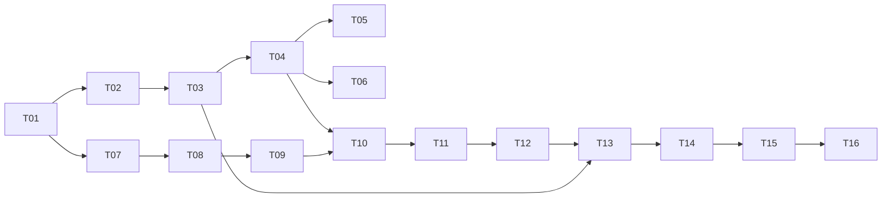

# Plan: v0.1

Drafted 2026-11-24, rewritten for Rust the same day (docs/decisions.md). This is the build plan for
the first release, written so that Claude Code, or OpenCode on Ivan's local model, can pick up one
task at a time and finish it without asking.

## How to work from this file (agents: read this first)

1. Read `AGENTS.md`, then this whole file once. The contracts below are shared by every task.
2. Take the **first task in Progress that isn't ticked and whose dependencies are ticked.** One task
   = one branch (named in the task) = one PR into `main`.
3. Build exactly what the task says. If something belongs to a later task or a later version, leave
   it. If the spec is wrong or unclear, fix the spec in this file in the same PR and say so in the
   PR description.
4. A task is done when every acceptance command passes, on Linux and Windows CI. Then tick it in
   Progress, in the same PR. Who merges follows the merge policy in `AGENTS.md`.
5. Tasks marked **explain** are the heart of the harness. Ivan wants to learn them, so explain each
   piece as it goes in: what it does, why it's there, and the Rust idiom used (ownership and
   borrowing, `Result` and `?`, enums and `match`, traits, serde derives, async and `select!`).
   Keep it brief, as you go.
6. **Who:**
   - **any**: mechanical and fully specified; fine for a local model.
   - **frontier**: needs judgment; use Claude Code or another frontier model.

## Progress

- [x] T01 Scaffold the package
- [x] T02 JSON, events and CLI output
- [x] T03 Config and `ork init`
- [x] T04 Model client and fake model server
- [x] T05 `ork doctor` and `ork models`
- [ ] T06 `ork ask`
- [ ] T07 Processes and the command policy
- [ ] T08 Git, worktrees and the job store
- [ ] T09 The grunt's tools
- [ ] T10 The grunt loop
- [ ] T11 Loop guards and context
- [ ] T12 Checks, repair turns and the report
- [ ] T13 `ork run`
- [ ] T14 Job commands: `jobs`, `status`, `diff`, `logs`, `apply`, `discard`
- [ ] T15 `ork guide`, the skill, the sync test, the README quickstart
- [ ] T16 Dogfood and release v0.1.0



T07–T09 can be built at the same time as T04–T06.

## What v0.1 is

`ork run` takes an order and runs the grunt loop on a local model in its own git worktree. It runs
the checks, gives the grunt repair turns, and reports back, from the command line with `--json`
and exit codes. The result can then be inspected, applied or discarded. Claude Code uses it through
its shell and the skill.

**v0.1 is done when:**
1. Every task is ticked and CI is green on Linux and Windows.
2. `cargo install --path . --locked` gives a working `ork`, and the v0.1.0 GitHub release has `ork`
   binaries for Linux and Windows.
3. Against the real model on the GPU box, `ork doctor` is all green, and at least 3 of 5
   hand-written orders on a real repo pass (logged in `docs/dogfood/v0.1.md`).
4. Claude Code, given only the skill, delegates one order with `ork run --json`, reads the report and
   applies it.

## Versions

| Version | What | Milestones (docs/iteration-1.md) |
|---|---|---|
| **v0.1** | CLI, one blocking run at a time: `doctor`, `models`, `init`, `ask`, `run`, `jobs`, `status`, `diff`, `logs`, `apply`, `discard`, `guide`; the skill | M0 (without MCP), M1, M2, the guide and skill from M4 |
| v0.2 | `ork mcp` (the official Rust SDK, `rmcp`), background jobs (`--detach`, `watch`), MCP Tasks, delegation rules written by `init` | M3, the rest of M4 |
| v0.3 | the eval (10 tasks with and without), bubblewrap on Linux, polish | M5 |

## Not in v0.1

- MCP, background jobs, `--detach`, `watch` (v0.2).
- SQLite: job files are enough until there's a daemon.
- Streaming responses, a token budget (only turn and minute limits).
- Tiers, plans, parallel grunts (iteration 3).
- Deleting files (the grunt can't delete in v0.1).
- Sandboxing beyond the path guard, the command allow-list and the env allow-list.
- `approve` and exit code 3 (reserved).
- `ork models --set/--server` (edit `ork.json` or re-run `ork init --force`).
- Publishing to crates.io (a separate decision).

## Decisions made for v0.1

These are also in docs/decisions.md.

- **Rust**, one package, shipped as one static binary `ork` (decided 2026-11-24, replacing .NET).
- **Model calls go over raw `reqwest` + `serde_json`**, not an LLM SDK or agent framework. Reasons:
  - You see the wire JSON from docs/agent-loop.md.
  - We get full control over malformed arguments, think blocks, tool calls written into the text, and
    llama.cpp extras (`timings`, `reasoning_content`).
  - It's one less abstraction.
- **`ModelClient` is a plain struct, not a trait.** There is one implementation; tests swap the
  server (the fake), not the client.
- **Tools are an `enum Tool`, dispatched with `match`.** The set is closed and known, so there are no
  trait objects and no `async-trait`.
- **Job state is files** under `.ork/jobs/<id>/`, not SQLite.
- **Commands run without a shell.** The command line is split into arguments, checked against the
  allow-list by prefix, and refused if it contains shell metacharacters.
- **`write_file` only creates new files**; existing files change through `edit_file` (exact match,
  once).
- **`.ork/` goes into `.git/info/exclude`**, so the user's `.gitignore` stays untouched.
- **Tests use `git grep` as the check command**: fast, needs nothing built, and works the same on
  Linux and Windows.
- **The CLI runs in-process in tests:** `main` only calls
  `cli::run(args, io, cwd, env, cancel)`.
- **The process-test helper is a second binary, `ork-testtool`, behind the `testtool` feature**, so
  `cargo install` never installs it. Tests find it with `env!("CARGO_BIN_EXE_ork-testtool")`; run
  the tests with `--all-features`.
- **CI runs on pull requests and on pushes to `main`**, not on every push (that ran each PR twice).

## Ground rules for implementers

- **Rust stable, pinned in `rust-toolchain.toml`** (with `rustfmt` and `clippy`), edition 2024.
  - `cargo fmt --check` and `cargo clippy --all-targets --all-features -- -D warnings` are clean;
    CI builds and tests with `RUSTFLAGS=-D warnings`.
  - `unsafe_code = "forbid"`.
- **One package, `orkestr8r`:** a library (`src/lib.rs`, where everything lives) and the `ork`
  binary (`src/main.rs`, a few lines). Library items that tests use are `pub`.
- **Tests live in one integration-test binary**, `tests/it/`, one module per area
  (`tests/it/output.rs`, `tests/it/config.rs`, …). Acceptance commands filter by module:
  `cargo test --all-features --test it output::`. Small pure helpers may also keep inline
  `#[cfg(test)]` tests.
- **JSON on every contract surface is snake_case.**
  - Rust field names already are; enums get `#[serde(rename_all = "snake_case")]`.
  - Every `Option` field is left out when `None`
    (`#[serde(default, skip_serializing_if = "Option::is_none")]`), except where a contract says
    `null` is sent.
  - `serde_json::to_string` for lines, `to_string_pretty` for files people read.
- **Config and order types are structs with `#[serde(default)]` and an `impl Default`** holding the
  defaults, so defaults survive missing keys. Reports and events are plain structs and enums with
  `#[derive(Debug, Clone, PartialEq, Serialize, Deserialize)]`.
- **Errors:** `anyhow::Result` everywhere, with `bail!` and `.context(…)` messages written for
  people. Tool failures are not Rust errors: they are `ToolResult { ok: false, output }`, which the
  model reads.
- No global mutable state. Compose objects by hand in `cli::run`.
- **Async with tokio**, and the Ctrl+C `CancellationToken` (`tokio_util`) passed all the way down:
  every long wait (a model call, a process) also watches it.
- **Cross-platform:**
  - Use `std::path`. Compare paths case-insensitively on Windows (`cfg!(windows)`).
  - Use `dunce::canonicalize`, not `fs::canonicalize` (no `\\?\` prefixes on Windows).
  - Never launch through a shell.
  - Slice strings on char boundaries only (`char_indices`), never at raw byte offsets.
- **Every task adds tests.** Tests touch the network only through the in-process fake server on
  127.0.0.1. Tests that need git create temporary repos (`tempfile`), set `core.autocrlf false`, and
  pass the identity with `-c user.name=…`.
- `ork` itself commits as `-c user.name=orkestr8r -c user.email=orkestr8r@localhost`, so no global
  git config is needed.
- **Add a crate in the task that first needs it**, at its current version:

  | Crate | For | Added in |
  |---|---|---|
  | `clap` (derive) | the CLI | T01 |
  | `tokio`, `tokio-util` | async, processes, timers, Ctrl+C, `CancellationToken` | T01 |
  | `anyhow` | errors | T01 |
  | `serde`, `serde_json` | every JSON surface | T02 |
  | `futures` | `catch_unwind` on handler futures | T02 |
  | `tempfile` (dev) | temp dirs and repos | T03 |
  | `reqwest` (rustls, no OpenSSL) | model calls | T04 |
  | `axum` (dev) | the fake model server | T04 |
  | `which` | finding executables (PATH, PATHEXT) | T05 |
  | `process-wrap` (tokio) | killing the whole process tree (process group / Job Object) | T07 |
  | `chrono` (serde) | timestamps in job state | T08 |
  | `fastrand` | job ids | T08 |
  | `globset` | `write_scope` | T09 |
  | `dunce` | canonical paths on Windows | T09 |

## Layout

```
Cargo.toml                 one package: the library, the `ork` binary, `ork-testtool` (feature `testtool`)
rust-toolchain.toml
.github/workflows/ci.yml
src/
  main.rs                  Ctrl+C → CancellationToken, then cli::run
  lib.rs
  env.rs                   Env: the environment as a value (case-insensitive names on Windows)
  io.rs                    SharedWriter: stdout/stderr shared by commands and sinks, capturable in tests
  config.rs                OrkConfig, loading, merging, validation
  events.rs                OrkEvent, EventSink, JsonLinesSink, HumanSink, FileSink, CompositeSink
  orders.rs                Order, OrderMode, validate, Report and its parts, JobStatus
  model/      mod.rs (ModelClient), wire.rs, think.rs, fallback.rs
  process/    mod.rs, split.rs, policy.rs, runner.rs, find.rs, truncate.rs
  git.rs
  jobs.rs                  job ids, JobState, JobStore
  tools/      mod.rs (Tool, ToolRegistry, ToolContext, ToolResult), args.rs, guard.rs,
              read_file.rs, list_dir.rs, grep.rs, write_file.rs, edit_file.rs, run.rs
  grunt/      mod.rs (GruntLoop), prompts.rs, first_message.rs, guards.rs, context.rs, transcript.rs
              (`grunt`, because `loop` is a keyword)
  checks.rs                CheckRunner
  runs.rs                  RunService
  cli/        mod.rs (clap types, run, the result wrapper), context.rs, exit.rs, guide.md,
              commands/ doctor.rs, models.rs, init.rs, ask.rs, run.rs, jobs.rs, guide.rs
  bin/ork-testtool.rs      sleep / print / exit / env, for the process tests
tests/it/
  main.rs                  `mod support; mod output; mod config; …`
  support/    mod.rs, fake_server.rs (FakeModelServer, Script), temp_repo.rs, cli.rs (runs the CLI in-process)
  scaffold.rs, output.rs, config.rs, model.rs, doctor.rs, ask.rs, processes.rs, git.rs, tools.rs,
  grunt.rs, checks.rs, run.rs, jobs.rs, guide.rs
skills/orkestr8r/SKILL.md
```

## Contracts shared by all tasks

```rust
// orders.rs
#[derive(Debug, Clone, Copy, Default, PartialEq, Eq, Serialize, Deserialize)]
#[serde(rename_all = "snake_case")]
pub enum OrderMode { #[default] Write, Readonly }

#[derive(Debug, Clone, Default, PartialEq, Serialize, Deserialize)]
#[serde(default)]
pub struct Order {
    pub goal: String,                 // required: OrderValidator checks it isn't empty
    pub context: Option<String>,
    pub paths: Vec<String>,           // files to seed into the first message
    pub write_scope: Vec<String>,     // globs, relative to the repo root
    pub checks: Vec<String>,          // command lines, must pass CommandPolicy
    pub mode: OrderMode,
    pub max_turns: Option<u32>,       // None → config default
    pub max_repairs: Option<u32>,
    pub max_minutes: Option<u32>,
}

#[derive(Debug, Clone, Copy, PartialEq, Eq, Serialize, Deserialize)]
#[serde(rename_all = "snake_case")]
pub enum JobStatus { Running, Passed, FailedChecks, GaveUp, Error, Applied, Discarded }

pub struct FileChange { pub path: String, pub added: u32, pub removed: u32 }
pub struct CheckResult { pub cmd: String, pub exit: i32, pub seconds: f64, pub tail: String }
pub struct TokenCount {
    #[serde(rename = "in")] pub input: u64,
    #[serde(rename = "out")] pub output: u64,
}
pub struct Report {
    pub job: String, pub status: JobStatus, pub summary: String,
    pub files_changed: Vec<FileChange>, pub checks: Vec<CheckResult>,
    pub repairs_used: u32, pub turns: u32, pub tokens: TokenCount, pub model: String, pub branch: String,
    pub open_questions: Vec<String>, pub reason: Option<String>,
}

// jobs.rs  →  .ork/jobs/<id>/state.json
pub struct JobState {
    pub id: String, pub status: JobStatus, pub goal: String, pub base_sha: String,
    pub branch: String, pub worktree: String,
    pub created_at: DateTime<Utc>, pub updated_at: DateTime<Utc>, pub reason: Option<String>,
}

// events.rs: internally tagged, so "event" is always the first key
#[derive(Debug, Clone, PartialEq, Serialize, Deserialize)]
#[serde(tag = "event", rename_all = "snake_case")]
pub enum OrkEvent {
    Start { command: String, job: Option<String>, branch: Option<String>, worktree: Option<String>,
            role: Option<String>, model: Option<String>, server: Option<String> },
    Call { turn: u32, model: String, server: String, tokens_in: u64, tokens_out: u64,
           seconds: f64, tokens_per_second: Option<f64> },
    Tool { turn: u32, name: String, args: Option<Value>, ok: bool, ms: u64,
           error: Option<String> },   // args: strings over 200 chars replaced by "<N chars>"
    Finish { turn: u32, summary: String },
    Check { cmd: String, exit: i32, seconds: f64, tail: String },
    Repair { attempt: u32 },
    Warning { code: String, message: String },
    Result { status: String, exit_code: i32, job: Option<String>, report: Option<Report>,
             data: Option<Value>, error: Option<String> },
}

pub trait EventSink: Send + Sync { fn emit(&self, event: &OrkEvent); }

// model/wire.rs
pub struct WireToolCall { pub id: String, #[serde(rename = "type")] pub kind: String,   // "function"
                          pub function: WireFunctionCall }
pub struct WireFunctionCall { pub name: String, pub arguments: String }                // a JSON *string*
pub struct WireMessage { pub role: String, pub content: Option<String>,                // content is sent as null when None
                         pub tool_calls: Option<Vec<WireToolCall>>, pub tool_call_id: Option<String> }
pub struct ToolSchema { pub name: String, pub description: String, pub parameters: Value }   // JSON Schema
pub struct ChatRequest { pub messages: Vec<WireMessage>, pub tools: Vec<ToolSchema>,          // empty → no tools sent
                         pub temperature: f64, pub max_tokens: u32 }
pub struct ToolCall { pub id: String, pub name: String, pub arguments: String }
pub struct ModelReply {
    pub content: Option<String>, pub reasoning: Option<String>, pub tool_calls: Vec<ToolCall>,
    pub finish_reason: Option<String>, pub tokens_in: u64, pub tokens_out: u64, pub seconds: f64,
    pub tokens_per_second: Option<f64>, pub warnings: Vec<String>, pub raw_json: String,
}

// model/mod.rs
impl ModelClient {
    pub fn new(server: &ServerConfig, role: &RoleConfig, api_key: Option<String>,
               request_timeout: Duration) -> anyhow::Result<Self>;
    pub async fn chat(&self, request: &ChatRequest) -> anyhow::Result<ModelReply>;
    pub async fn list_models(&self) -> anyhow::Result<Vec<String>>;
}

// tools/mod.rs
pub struct ToolResult { pub ok: bool, pub output: String }
pub struct ToolContext {
    pub root: PathBuf, pub order: Order, pub guard: PathGuard, pub runner: ProcessRunner,
    pub policy: CommandPolicy, pub config: OrkConfig, pub cancel: CancellationToken,
}
#[derive(Debug, Clone, Copy, PartialEq, Eq)]
pub enum Tool { ReadFile, ListDir, Grep, WriteFile, EditFile, Run, Finish }
impl Tool {
    pub fn name(self) -> &'static str;
    pub fn from_name(name: &str) -> Option<Tool>;
    pub fn schema(self) -> ToolSchema;
    pub fn writes(self) -> bool;
    pub async fn run(self, args: &Value, ctx: &ToolContext) -> ToolResult;   // Finish is handled by the loop
}

// grunt/mod.rs
pub struct FinishCall { pub turn: u32, pub summary: String, pub open_questions: Vec<String> }
pub enum FinishVerdict {
    Accept,
    Reject(String),   // sent back as the finish tool's result
}
pub trait FinishHandler {
    // implementations write `async fn on_finish(&mut self, call: FinishCall) -> FinishVerdict`
    fn on_finish(&mut self, call: FinishCall) -> impl Future<Output = FinishVerdict> + Send;
}
pub enum LoopEnd { Finished, GaveUp, Error }
pub struct LoopOutcome {
    pub end: LoopEnd, pub summary: Option<String>, pub open_questions: Vec<String>,
    pub reason: Option<String>, pub turns: u32, pub tokens_in: u64, pub tokens_out: u64,
}
```

**Exit codes** (`cli/exit.rs`): `OK = 0`, `ERROR = 1`, `WAITING = 3` (reserved in v0.1),
`CHECKS_FAILED = 4` (also used for `gave_up`).

**Job files**, under `.ork/jobs/<id>/`:

| File | What |
|---|---|
| `order.json` | the order as run |
| `state.json` | `JobState`, written atomically (temp file + `fs::rename`) |
| `events.jsonl` | every event |
| `transcript.jsonl` | every message sent to or received from the model, plus one `meta` line per reply |
| `report.json` | the report |

The worktree lives in `.ork/worktrees/<id>`, on branch `ork/<id>`.

---

## T01 · Scaffold the package

**Branch** `feat/scaffold` · **Depends on** none · **Who** any

**Goal:** a package that builds, lints and tests on Linux and Windows CI, with `ork --version`.

**Files**
- `Cargo.toml`, `Cargo.lock`, `rust-toolchain.toml`
- `.gitignore` (`/target`, `.ork/`), `.gitattributes` (`* text=auto eol=lf`) and `.editorconfig`
- `.github/workflows/ci.yml`
- `src/main.rs`, `src/lib.rs`, `src/env.rs`, `src/io.rs`, `src/cli/mod.rs`, `src/cli/exit.rs`
- `scripts/dcargo.sh` (cargo in a rust container, for machines that can't link natively)
- `src/bin/ork-testtool.rs`
- `tests/it/main.rs`, `tests/it/scaffold.rs`

**Details**
- **`Cargo.toml`:**
  - Package `orkestr8r`, `version = "0.1.0-dev"`, `edition = "2024"`, `rust-version` = the pinned
    toolchain, `license = "MIT"`, `publish = false` for now.
  - `[[bin]] name = "ork"`; `[[bin]] name = "ork-testtool"` with `required-features = ["testtool"]`;
    `[features] testtool = []`.
  - `[lints.rust] unsafe_code = "forbid"`.
  - Dependencies: `clap` (derive), `tokio` (macros, rt-multi-thread, signal, process, time, fs,
    io-util, sync), `tokio-util`, `anyhow`.
- **`rust-toolchain.toml`:** an exact stable version (`1.99.1`, not `1.99`: rustup treats those as
  different toolchains), with `rustfmt` and `clippy`.
- **`main.rs`** is a few lines: a `CancellationToken` cancelled by `tokio::signal::ctrl_c()`, then
  `std::process::exit(cli::run(args, CliIo::stdio(), cwd, Env::from_process(), cancel).await)`.
- **`cli::run(args: Vec<String>, io: CliIo, cwd: PathBuf, env: Env, cancel: CancellationToken) -> i32`:**
  - `CliIo { stdout, stderr }` holds two shareable writers (`Arc<Mutex<…dyn Write + Send>>`).
    `CliIo::stdio()` is the real ones; `CliIo::capture()` returns the io plus two buffers that tests
    read back.
  - `Env` is the environment as a map (`Env::from_process()`, or built from pairs in tests). Names
    are case-insensitive on Windows.
- **`cli::command()`** returns the `clap::Command` (`Cli::command()` through `CommandFactory`); T15's
  test enumerates its subcommands.
- **clap output:** `--version` prints `ork 0.1.0-dev` and `--help` prints help, both to stdout with
  exit 0. Other parse errors print clap's message to stderr and exit **1**, not clap's default 2 (the
  contract says 1).
- **`ork-testtool`:** `sleep SECONDS`, `print LINES` (prints `line 1` … `line N`), `exit CODE`, and
  `env NAME` (prints the variable, nothing when unset), for the process tests in T07.
- **CI** (`.github/workflows/ci.yml`):
  - `on: pull_request` and `push` to `main`.
  - Matrix `ubuntu-latest`, `windows-latest`; `RUSTFLAGS: -D warnings`.
  - Steps: `actions/checkout`, `rustup toolchain install` (reads `rust-toolchain.toml`),
    `Swatinem/rust-cache`, then `cargo fmt --check`,
    `cargo clippy --all-targets --all-features -- -D warnings`, `cargo test --all-features`,
    `cargo build --release`.
- **Test:** `tests/it/scaffold.rs` runs `cli::run(["ork", "--version"], …)` in-process and checks
  stdout starts with `ork 0.1.0`.

**Acceptance**
```
cargo fmt --check
cargo clippy --all-targets --all-features -- -D warnings
cargo test --all-features
cargo run -- --version          # ork 0.1.0-dev
cargo build --release           # target/release/ork (ork.exe on Windows)
```

## T02 · JSON, events and CLI output

**Branch** `feat/output` · **Depends on** T01 · **Who** any

**Goal:** every command can emit events as JSON Lines or human lines, and the `result` event is
always last, whatever happens.

**Files:** `src/events.rs`, `src/orders.rs` (the `Report` types, which `result` carries),
`src/cli/context.rs`, `src/cli/mod.rs`.

**Details**
- `OrkEvent` exactly as in Contracts. `serde_json::to_string(&event)` writes `event` first (serde
  writes the tag of an internally tagged enum before the fields).
- **Sinks** (all `EventSink`, interior `Mutex` where they write):
  - `JsonLinesSink(writer)`: one line per event, flush after each.
  - `FileSink(path)`: appends a line (open in append mode, write, close).
  - `HumanSink(stderr)`: one short line per event; see the example below.
  - `CompositeSink(Vec<Box<dyn EventSink>>)`.
- **`--json`** is a global flag on the root (`#[arg(long, global = true)]`).
- **`CliContext`** carries:
  - `stdout`, `stderr`, `cwd`, `env`, `cancel`;
  - `json` (bool);
  - `events` (JsonLines to stdout when `--json`, else Human to stderr).
- **Each command handler returns `anyhow::Result<CommandResult>`**, where
  `CommandResult { status, exit_code, job, report, data, error }` holds the `result` fields
  (helpers: `CommandResult::ok()`, `ok_with(data)`, `error(message)`).
  - Human output goes through `ctx.say(line)` (stdout, only without `--json`); notes for people
    through `ctx.note(line)` (stderr, always); events through `ctx.emit(event)`.
  - The wrapper, `cli::complete(&ctx, handler_future) -> i32`, is `pub` so tests can drive it:
    - `Ok(result)` → that result;
    - `Err(e)` → status `error`, exit 1, `error` = `format!("{e:#}")` (the context chain on one
      line); with `ORK_DEBUG=1` also `{e:?}` on stderr (a backtrace when `RUST_BACKTRACE=1`);
    - a panic (caught with `futures::FutureExt::catch_unwind` around `AssertUnwindSafe(fut)`) →
      status `error`, `error` = `internal error: <panic message>`.
  - Then it emits exactly one `result` event.
  - Without `--json`, the command's human output goes to stdout and the result line goes to stderr
    as `error: …` (or nothing when the status is ok).
- **Parse errors:**
  - With `--json` anywhere in the args, emit a `result` with status `error`, clap's message
    (rendered without colour) in `error`, and exit 1.
  - Without it, keep clap's own output and exit 1.

Human line examples (stderr):
```
ork run k7f2 · grunt qwen-27b on box · .ork/worktrees/k7f2
  t1  read_file src/Orders/OrderQuery.cs   ok  3ms   6.1k→212 tok  52 t/s
  t6  edit_file src/Orders/OrderQuery.cs   ok
  ✗ dotnet test tests/Orders  exit 1  14.2s
  repair 1
  ✓ dotnet test tests/Orders  13.8s
passed · 11 turns · 1 repair · 61.2k in / 4.8k out
```

**Tests** (`tests/it/output.rs`)
- Every event round-trips with `event` first.
- `result` is last when the handler returns an error, and when it panics.
- A parse error with `--json` gives one valid `result` line and exit 1.
- Without `--json`, stdout has no JSON.

**Acceptance:** `cargo test --all-features --test it output::`

## T03 · Config and `ork init`

**Branch** `feat/config` · **Depends on** T02 · **Who** any

**Goal:** load `ork.json` from the user and repo locations with defaults, validate it, and let
`ork init` write it.

**Files:** `src/config.rs`, `src/git.rs` (just `add_exclude` for now), `src/cli/commands/init.rs`.

**Details**
- Types (structs with `#[serde(default)]` and `impl Default`, defaults as shown):
  ```
  OrkConfig      { servers: BTreeMap<String, ServerConfig> = {}, roles: BTreeMap<String, RoleConfig> = {},
                   allow_commands: Vec<String> = [], defaults: DefaultsConfig }
  ServerConfig   { url (required), key_env: Option<String> }
  RoleConfig     { server (required), model (required), context_tokens = 32768, temperature = 0.2,
                   max_output_tokens = 8192 }
  DefaultsConfig { max_turns = 40, max_repairs = 2, max_minutes = 20, tool_timeout_seconds = 300,
                   check_timeout_seconds = 600, request_timeout_seconds = 600 }
  ```
  "Required" strings default to empty, and validation reports them.
- **Locations, applied in order:**
  1. built-in defaults;
  2. the user file, from the `Env` given to `cli::run` (so tests stay hermetic):
     `%APPDATA%\orkestr8r\ork.json` on Windows, else `$XDG_CONFIG_HOME/orkestr8r/ork.json`, or
     `$HOME/.config/orkestr8r/ork.json`;
  3. the repo file `<repo root>/ork.json`. The repo root is the nearest directory, walking up from
     the cwd, that has a `.git` entry (a directory, or a file in a worktree).
  - If `ORK_CONFIG` is set, that file replaces both 2 and 3.
- **Merge:** load each file as a `serde_json::Value` and deep-merge objects, with later files
  winning. Arrays are replaced, not merged. Then deserialize once (`serde_json::from_value`).
- **Validation (`OrkConfig::validate`)** returns every problem with its JSON path:
  - role `grunt` exists;
  - every role's server exists, and its `server` and `model` aren't empty;
  - URLs start with `http://` or `https://` and have a host;
  - numbers are > 0, except `max_repairs` (0 = no repair turns) and `temperature` (0 or more).
- **API key:** `env[key_env]` when `key_env` is set. Never read a key from the file.
  - **Only for a server whose `url` and `key_env` the user file (or `ORK_CONFIG`) sets exactly.**
    If the repo file changes them, `key_env` is dropped and `LoadedConfig.warnings` says so
    (commands emit it as a `warning`, code `key_ignored`). Otherwise a cloned repo could point a
    server at its own host, or name another variable as the key, and receive it as a Bearer token.
- **`ork init --url URL --model MODEL [--key-env VAR] [--context-tokens N] [--user] [--force]`:**
  - `--key-env` needs `--user` (see API key above).
  - Writes `servers.box` and `roles.grunt` to the repo file, or to the user file with `--user`
    (pretty JSON, only the keys `init` sets).
  - Detects `allow_commands` (all that apply, in this order):
    - a `Cargo.toml` → `cargo build`, `cargo test`;
    - a `go.mod` → `go build`, `go test`;
    - a `*.sln`, `*.slnx` or `*.csproj` → `dotnet build`, `dotnet test`;
    - a `package.json` → `npm test`, `npm run lint`;
    - none → an empty list, plus a warning.
  - Adds `.ork/` to `<git common dir>/info/exclude` if it's missing (repo file only), with
    `git::add_exclude(root)`: `git rev-parse --git-common-dir` through `std::process::Command`, then
    append. T08 moves it onto the `Git` struct.
  - Refuses to overwrite without `--force`, and refuses to write a config that fails validation
    (e.g. a bad `--url`), listing the problems.
  - `result.data` = `{ "path": "…" }`.

**Tests** (`tests/it/config.rs`)
- The precedence order.
- `ORK_CONFIG` override.
- Missing `grunt` → an error naming `roles.grunt`.
- Defaults survive a file that only has `servers` and `roles`.
- `init`: writes the file and the exclude line (idempotent), and refuses to overwrite.

**Acceptance:** `cargo test --all-features --test it config::`

## T04 · Model client and fake model server · **explain**

**Branch** `feat/model-client` · **Depends on** T03 · **Who** frontier

**Goal:** one struct that talks to any OpenAI-compatible server and hides nothing, plus the fake
server that every later test uses.

**Files:** `src/model/*`, `tests/it/support/fake_server.rs`, `tests/it/model.rs`.

**Details**
- **`ModelClient`** (Contracts) holds a `reqwest::Client` built with the request timeout
  (`request_timeout_seconds`).
- **Request:** `POST {url}/chat/completions` (the url already ends in `/v1`), body:
  - `{ model, messages, tools?, tool_choice: "auto" (only when tools), temperature, max_tokens, stream: false }`;
  - tools in the OpenAI shape: `{ "type": "function", "function": { name, description, parameters } }`;
  - an `Authorization: Bearer` header when the key is set.
- **`list_models`:** `GET {url}/models` → `data[].id`.
- **Parse the response as a `serde_json::Value`, tolerantly** (missing fields become defaults, not
  errors):
  - `choices[0].message.content`, `.tool_calls[]` (`id`, `function.name`, `function.arguments`),
    `.reasoning_content` (or `.reasoning`, as vLLM and OpenRouter name it);
  - `choices[0].finish_reason`;
  - `usage.prompt_tokens` and `usage.completion_tokens`;
  - llama.cpp's `timings.predicted_per_second` when present, else completion tokens ÷ seconds.
  - Keep `arguments` as the raw string; the tool layer validates it. (When a server sends it as an
    object, re-serialize it to a string.)
  - A call without an `id` gets `call_N`: its result has to be tied to it.
  - Keep the whole body in `raw_json`.
  - A reply with no `choices[0]` is an error (servers send `{"error": …}` with a 200 sometimes).
- **`think::strip(&str) -> (String, bool)`:**
  - remove `<think>…</think>` blocks;
  - remove everything before an orphan `</think>`;
  - remove everything after an unclosed `<think>`;
  - trim.
  - Add a warning `think_stripped` when anything was removed.
  - `reasoning_content` is never added to messages; it goes only into the transcript.
- **`fallback`:** when `tool_calls` is empty and the content has `<tool_call>{…}</tool_call>` blocks
  (Hermes/Qwen style, seen when a server's chat template doesn't parse tool calls), parse each
  `{ "name", "arguments" }` into a `ToolCall` with the id `fallback_N` (`arguments` re-serialized to
  a string when it's an object). Remove the blocks from the content and add a warning
  `tool_calls_in_content`.
- **Errors:**
  - Network errors, 429 and 5xx → retry twice, after 2 s and 5 s. The delays are a field
    (`retry_delays`) so tests set them to zero.
  - Other 4xx → an error with the status and the first 500 characters of the body.
  - The request timeout comes from `request_timeout_seconds`. A timeout is **not** retried: the
    model is just slow, and a retry would double a long wait.
  - **Cancelling is by drop**, so `chat` takes no token: a Rust future only runs while polled, and
    dropping it cancels it. Callers race it against the cancel token in `tokio::select!`; when the
    token wins, the future is dropped and reqwest closes the connection.
- **reqwest** with `default-features = false, features = ["rustls", "json"]` (rustls with aws-lc,
  no OpenSSL; no http2 or system proxy settings needed).
- **Fake server (`FakeModelServer`):**
  - axum on `tokio::net::TcpListener::bind("127.0.0.1:0")`; read the port from `local_addr()`;
    serve in a spawned task that is aborted on drop. `base_url()` = `http://127.0.0.1:{port}/v1`.
  - `POST /v1/chat/completions` → the next step of a `Script`; when the script runs out, 500
    `script exhausted`.
  - `GET /v1/models` → the ids it was started with.
  - Every request is recorded: `requests() -> Vec<Value>` (the chat bodies), `recorded()` (path,
    `Authorization` header, body).
  - Script builder: `Script::new().tool_call(name, json!({…}))`, `.tool_calls(vec![…])`,
    `.text(s)`, `.malformed_args(name, raw)`, `.raw(json_str)`, `.status(code)`. Every step uses
    fixed usage numbers (100 in, 20 out); call ids run `call_1`, `call_2`, … across the script.
  - Helpers: `server.client()` (a `ModelClient` for `fake-model`, no retry delays),
    `client_with_key(…)`, `server_config()`, and `unreachable_url()` (a port nothing listens on).
  - The think-stripping and fallback cases are tests in `tests/it/model.rs` too, so the acceptance
    filter runs them.

**Tests** (`tests/it/model.rs`)
- Tool calls are parsed.
- Each think-stripping case.
- The fallback parses `<tool_call>` blocks.
- 500 then 200 → success after one retry.
- 400 → an error with the body.
- The auth header is sent only when a key is set.
- `raw_json` is kept.

**Acceptance:** `cargo test --all-features --test it model::`

**Learn (explain while building):**
- what the request and response look like (docs/agent-loop.md);
- why `arguments` is a string that can be broken;
- what `finish_reason` tells us (`stop`, `tool_calls`, `length`);
- why think blocks are stripped instead of kept in the history;
- why the response is read as a `Value` rather than strict structs.

## T05 · `ork doctor` and `ork models`

**Branch** `feat/doctor` · **Depends on** T04 · **Who** any

**Files:** `src/cli/commands/doctor.rs`, `models.rs`, `src/process/find.rs` (also used by T07).

**Details**
- **`ork doctor [--json]`** runs these checks in order; each gives `{ name, ok, detail, hint? }`:
  1. `config`: loaded from where; validation problems.
  2. `git`: `git --version`, and whether the cwd is inside a repo.
  3. `server`: `GET /models` answers; warn (still ok) if the role's model isn't listed.
  4. `tool_calling`: one request with a single tool, `ping(value: string)`, and the user message
     `Call the ping tool with value "pong".`. It passes when the reply has a tool call named `ping`.
     On failure the hint is: "the model replied with text instead of a tool call; for llama-server,
     check the chat template / --jinja, or try another model".
  5. `commands`: the executable of every `allow_commands` entry is found on PATH.
  - Exit 0 if all pass, else 1 (`error` = "N of 5 checks failed"). `result.data` =
    `{ "checks": [...] }`.
  - Doctor's model requests are not retried: a down server should show at once, not after the
    backoff.
  - The client comes from `ModelClient::for_role(config, "grunt", env)` (also used by `ask` and
    `run`): the role's server, model, key and the config's request timeout.
- **`process::find(name, env, cwd)`:** `which::which_in` over the `PATH` from `env` (PATHEXT on
  Windows is handled by `which`).
- **`ork models [--test] [--json]`:**
  - Lists each role → server, url, model, whether the key is set.
  - `--test` sends `Reply with OK.` per role (no retries) and reports seconds, tokens and tokens
    per second. `result.data` = `{ "roles": [{ role, server, url, model, key_set, test? }] }`.

**Tests** (`tests/it/doctor.rs`), with the fake server:
- all pass;
- a tool-calling failure (`Script::text`);
- the server down (an unused port) gives `server` and `tool_calling` failing, with exit 1.

**Acceptance:** `cargo test --all-features --test it doctor::`

## T06 · `ork ask`

**Branch** `feat/ask` · **Depends on** T04 · **Who** any

**Goal:** a one-shot, read-only answer about files from the local model. No loop, no tools. This
finishes M0, without MCP (moved to v0.2).

**Details**
- `ork ask "QUESTION" --path FILE [--path …] [--json]`. Paths are relative to the cwd and must exist.
- One request:
  - system: `Answer the question about the files below. Be concise. Cite file:line where it helps.`
  - user: the question, then each file in a fenced block with numbered lines.
  - Each file is capped at 400 lines and the total at 48,000 characters; add a `truncated` warning
    when anything is cut.
- The answer (think blocks stripped) goes to stdout. With `--json`, `result.data` =
  `{ answer, model, tokens_in, tokens_out, seconds }`.

**Tests** (`tests/it/ask.rs`):
- The request contains the numbered file content.
- The answer is printed.
- Think blocks are stripped.
- A missing file → exit 1.

**Acceptance:** `cargo test --all-features --test it ask::`

## T07 · Processes and the command policy

**Branch** `feat/processes` · **Depends on** T01 · **Who** any

**Files:** `src/process/*`.

**Details**
- **`split(&str) -> anyhow::Result<Vec<String>>`** → argv.
  - Whitespace separates arguments.
  - `"…"` and `'…'` group; `\"` is allowed inside double quotes.
  - An unclosed quote is an error.
- **`CommandPolicy::new(allow: Vec<String>)`, `check(&self, cmd: &str) -> Result<Vec<String>, String>`**
  → the argv, or the reason it's refused.
  - Refuse any of the characters ``; & | < > $ ` `` or a newline.
  - Allowed when argv starts with every token of some allow entry, token by token: `cargo test`
    allows `cargo test --test it`, not `cargo run`.
- **`ProcessRunner::new(env: Env)`, `run(&self, spec: ProcessSpec, cancel: &CancellationToken)
  -> anyhow::Result<ProcessResult>`**, where
  `ProcessSpec { argv: Vec<String>, cwd: PathBuf, timeout: Duration }`:
  - The program is `process::find(argv[0])`; the rest are arguments; stdin is null.
  - Spawn through `process-wrap` (tokio): a new process group on Unix, a Job Object on Windows, so a
    timeout or a cancel kills the whole tree, not just the direct child.
  - Capture stdout and stderr into one buffer, in arrival order (read both pipes concurrently and
    append to one shared buffer). Keep at most 1 MB: the first and last 512 KB. Decode as lossy
    UTF-8.
  - Returns `ProcessResult { exit_code: i32, output: String, timed_out: bool, seconds: f64 }`
    (`exit_code` is -1 when there is none, e.g. killed by a signal).
  - **Environment:** clear it (`env_clear`), then copy only these variables from the runner's
    `Env`:
    - `PATH`, `HOME`, `USER`, `LANG`, `LC_ALL`, `TMPDIR`, `TEMP`, `TMP`;
    - Windows: `USERPROFILE`, `APPDATA`, `LOCALAPPDATA`, `PROGRAMDATA`, `SystemRoot`, `SystemDrive`,
      `windir`, `ComSpec`, `PATHEXT`, `NUMBER_OF_PROCESSORS`, `PROCESSOR_ARCHITECTURE`;
    - toolchains: `CARGO_HOME`, `RUSTUP_HOME`, `RUSTUP_TOOLCHAIN`, `GOPATH`, `GOCACHE`,
      `GOMODCACHE`, `NUGET_PACKAGES`, and everything starting with `DOTNET_`. (Not all `NUGET_*`
      or `CARGO_*`: those can carry tokens, e.g. `NUGET_AUTH_TOKEN`, `CARGO_REGISTRY_TOKEN`.)
    - Then set `CI=true`, `NO_COLOR=1`, `TERM=dumb`, `CARGO_TERM_COLOR=never`,
      `DOTNET_CLI_TELEMETRY_OPTOUT=1`, `DOTNET_NOLOGO=1`.
- **`truncate::head_tail(s: &str, max: usize)`** (`max` = 4,000 by default) → the first 2,000
  characters + `\n…[N chars cut]…\n` + the last 2,000. Counted in chars, cut on char boundaries.

**Tests** (`tests/it/processes.rs`)
- Split cases: quotes, the escape, an unclosed quote.
- Policy cases: allowed, prefix mismatch, each metacharacter.
- The runner with `ork-testtool` (`env!("CARGO_BIN_EXE_ork-testtool")`):
  - `exit 3` → 3;
  - `print 5` → five lines;
  - `sleep 30` with a 1 s timeout → `timed_out`, killed;
  - `env SECRET_X` prints nothing even when the test's `Env` has `SECRET_X`.
- `head_tail` on multi-byte text doesn't panic.

**Acceptance:** `cargo test --all-features --test it processes::`

## T08 · Git, worktrees and the job store

**Branch** `feat/git-jobs` · **Depends on** T07 · **Who** any

**Files:** `src/git.rs`, `src/jobs.rs`, `tests/it/support/temp_repo.rs`.

**Details**
- **`Git::new(runner: ProcessRunner)`**: every call runs `git -c user.name=orkestr8r -c user.email=orkestr8r@localhost …`
  and returns an error with the output on a non-zero exit. Methods:
  - `repo_root(cwd)` (`rev-parse --show-toplevel`), `head_sha(root)`, `current_branch(root)`.
  - `is_clean(root)`: `status --porcelain`, ignoring lines under `.ork/`.
  - `add_exclude(root, ".ork/")`: append to `$(git rev-parse --git-common-dir)/info/exclude` if
    missing (replaces T03's free function).
  - `worktree_add(root, path, branch, base_sha)`: `worktree add -b <branch> <path> <sha>`.
  - `commit_all(dir, message)`: `add -A`, then `commit -m`; returns the sha, or `None` when nothing
    changed.
  - `num_stat(root, base_sha, branch)`: `diff --numstat base..branch` → `FileChange` (binary `-` →
    0/0).
  - `diff(root, base_sha, branch, stat)`.
  - `merge(root, branch, squash, message)`: `--no-ff --no-edit -m`, or `--squash` followed by
    `commit -m`; on a conflict, `merge --abort` and return an error.
  - `worktree_remove(root, path)`: `worktree remove --force`.
  - `branch_delete(root, branch, force)`.
  - `ls_files(dir)`: `ls-files --cached --others --exclude-standard`.
- **`JobId::new(existing)`:** 4 characters from `abcdefghjkmnpqrstuvwxyz23456789`, regenerated on a
  collision.
- **`JobStore::new(root)`:**
  - `create(order, base_sha)` → writes `order.json` and `state.json` (status `running`) and returns
    the paths.
  - `load(id)`, `list()` (newest first), `set_status(id, status, reason)`, `write_report`.
  - `events_path`, `transcript_path`.
- **`TempRepo`** (tests): a temp dir with `git init`, `core.autocrlf false`, an identity, and helpers
  to write files and commit.

**Tests** (`tests/it/git.rs`, temp repos)
- A worktree is created from HEAD on `ork/<id>`.
- `commit_all` returns `None` on no change.
- `num_stat` numbers.
- A squash and a no-ff merge.
- A conflict aborts cleanly.
- The exclude line is added once.
- `is_clean` ignores `.ork/`.
- Job ids are unique.
- `state.json` survives a crash mid-write (the temp file is left alone).

**Acceptance:** `cargo test --all-features --test it git::`

## T09 · The grunt's tools · **explain**

**Branch** `feat/tools` · **Depends on** T08 · **Who** frontier for `args`, `PathGuard` and the
registry; any for the individual tools

**Files:** `src/tools/*`.

**Details**
- **`args::validate(args_json: &str, schema: &Value) -> Result<Value, String>`.**
  - It supports the subset we use: `type: object`, `properties`, `required`, and the types `string`,
    `integer`, `boolean`, and `array` of strings.
  - The error says what was wrong and shows the expected schema, because the model reads it.
- **`PathGuard::new(root, write_scope)`:**
  - **`resolve(&self, rel: &str, write: bool) -> Result<PathBuf, String>`:**
    - Join with the root and normalize lexically (`.` and `..` resolved without touching the disk).
      The result must be the root or under it, compared component by component
      (case-insensitively on Windows). An absolute `rel` that lands outside fails the same check.
    - No path segment may be `.git`.
    - The deepest part of the path that exists is canonicalized (`dunce::canonicalize`) and must
      also be under the canonical root, so a symlink anywhere on the path can't lead out.
  - **For writes, the path must also match `write_scope`:**
    - a `globset::GlobSet` built with `GlobBuilder::new(p).literal_separator(true)` (so `*` doesn't
      cross `/`), case-insensitive on Windows;
    - test the path relative to the root, with forward slashes.
- **Tools.** Each has a JSON Schema and returns `ToolResult`. Errors are results the model can
  read, never Rust errors or panics.

  | Tool | Arguments | Behaviour |
  |---|---|---|
  | `read_file` | `path`, `start?`, `end?` (1-based, inclusive) | Header `path (lines a-b of N)`, then `{n:>5} │ line` per line. At most 400 lines; past that, say how to read more. Errors: not found, a directory, binary (NUL in the first 8 KB) |
  | `list_dir` | `path?` = `.`, `depth?` = 2 (max 4) | A tree built from `git ls-files` under the path, with directories ending in `/`. At most 300 entries, then `… N more` |
  | `grep` | `pattern`, `path?`, `glob?` | If `rg` is on PATH: `rg -n --no-heading --color never -m 50 -e PATTERN [-g GLOB] -- PATH`. Else `git grep -n -I --untracked -e PATTERN -- PATH` (glob → `:(glob)GLOB`). At most 100 lines; no match → ok, `no matches` |
  | `write_file` | `path`, `content` | New files only (an existing file → error "exists; use edit_file"). Must be in scope. Creates parent directories. Returns `wrote N lines to path` |
  | `edit_file` | `path`, `old`, `new` | The file must exist and be in scope. `old` must occur exactly once: 0 → "not found; read_file the region again, whitespace must match"; more than 1 → "found N times; include more surrounding lines". If the file uses `\r\n`, convert `\n` in `old`/`new` first. Returns `edited path (-a +b lines)` and 3 numbered lines around the change |
  | `run` | `cmd` | `CommandPolicy` must allow it (refused → error with the reason and the allow-list). Runs in the root with `tool_timeout_seconds`. Result: `exit {code} in {s}s` + `head_tail(output)`. Ok even when exit ≠ 0 (the model reads the code); a timeout → not ok |
  | `finish` | `summary`, `open_questions?` | Schema only; the loop handles it |

- **`ToolRegistry::for_mode(OrderMode)`:**
  - `write` → all tools;
  - `readonly` → `read_file`, `list_dir`, `grep`, `finish`.
  - `schemas()` gives the list sent to the model; `get(name)` → `Option<Tool>`.

**Tests** (`tests/it/tools.rs`): for every tool, the happy path and each error, plus:
- path escapes: `../x`, an absolute path outside, `.git/config`, a symlink out (skipped when the
  symlink can't be created, e.g. Windows without the privilege);
- out of scope;
- `edit_file` uniqueness and CRLF;
- `run` refused;
- `readonly` has no writing tools.

**Acceptance:** `cargo test --all-features --test it tools::`

**Learn:**
- why errors go back to the model as text instead of being Rust errors;
- why `edit_file` needs an exact, unique match, while whole-file rewrites mangle code with local
  models;
- how the path guard and the scope keep a grunt inside its job;
- why a closed `enum` + `match` beats trait objects here.

## T10 · The grunt loop · **explain**

**Branch** `feat/loop` · **Depends on** T04, T09 · **Who** frontier

**Goal:** the agent loop from docs/agent-loop.md, real.

**Files:** `src/grunt/mod.rs`, `prompts.rs`, `first_message.rs`, `transcript.rs`.

**Details**
- **`prompts::GRUNT_SYSTEM`** (start from this text; tune it in T16):
  ```
  You are a coding agent working inside a git worktree. You act only through the tools.
  - Work toward the goal. Change only files that match the write scope.
  - Read before you edit. Change existing files with edit_file: `old` must match the file exactly, once.
    Use write_file only for new files.
  - Keep your messages short. Don't describe plans at length; act.
  - When the goal is met, call finish with a short summary. orkestr8R then runs the checks; if they fail,
    you get the output and can fix the problem.
  - If something blocks you (missing information, an impossible goal), call finish and put the question
    in open_questions.
  ```
- **`first_message::render(order, seed)`** → Markdown with these sections:
  - `## Goal`;
  - `## Context` (when given);
  - `## Files you may change` (the scope);
  - `## Checks` ("run when you call finish");
  - `## Repository` (a depth-2 tree from `ls_files`, at most 200 entries);
  - `## Files` (each of `paths`, numbered, at most 400 lines each and 40,000 characters in total,
    with "(truncated; use read_file)" when cut).
- **`GruntLoop::new(model: &ModelClient, tools: ToolRegistry, events: &dyn EventSink, transcript: Transcript, settings: LoopSettings)`**,
  with `run(&mut self, order: &Order, ctx: &ToolContext, on_finish: &mut impl FinishHandler) -> LoopOutcome`:
  - `messages = [system, user(first message)]`.
  - **Per turn, up to `max_turns`, before a deadline of `max_minutes`** (a `tokio::time::Instant`;
    each model call and tool run sits in a `tokio::select!` with `sleep_until(deadline)` and
    `cancel.cancelled()`):
    1. `chat`.
    2. Emit `call`.
    3. Write the reply's `meta` and `raw_json` to the transcript.
    4. Append the assistant message: stripped content plus `tool_calls` exactly as received
       (fallback calls get their generated ids).
  - **For each tool call:**
    - `finish` → `on_finish`.
      - `Accept` → append the tool result `accepted` and return `Finished`.
      - `Reject(feedback)` → append the feedback as the finish call's tool result and go on.
    - Otherwise: validate the arguments, then run or produce the error, then append
      `tool(call.id, head_tail(output))`, then emit `tool`.
  - Every tool call in a reply must get its tool message before the next request.
  - Turns run out → `GaveUp("max_turns")`. The deadline passes → `GaveUp("max_minutes")`. A model
    error after retries → `Error`. Cancelled → `Error("cancelled")`.
- **`Transcript`:** append one JSON line per message (`{ "turn", "role", "content", "tool_calls"?, "tool_call_id"? }`)
  and one `meta` line per reply (`finish_reason`, tokens, seconds, warnings, `reasoning_content`,
  raw).
- **In T10, tests pass an `on_finish` that always accepts.** T12 plugs in the checks.

**Tests** (`tests/it/grunt.rs`): scripted against the fake server, in a temp worktree:
- `read_file` → `write_file` → `finish` → `Finished`, the file exists, and request 2 contains the
  tool message with the file's content and the right `tool_call_id`.
- A tool error goes back as text.
- Two tool calls in one reply each get a tool message.
- `max_turns` → `GaveUp`.
- A `Reject` from `on_finish` reaches the model, which can finish again.

**Acceptance:** `cargo test --all-features --test it grunt::`

**Learn:**
- the message list as the model's whole memory;
- pairing `tool_call_id`s;
- why the assistant message goes in before the tool results;
- why `finish` is a tool and not just "no tool calls";
- how `on_finish` keeps checks out of the loop (a trait with an `async fn`);
- `tokio::select!`: racing the work against the deadline and Ctrl+C.

## T11 · Loop guards and context · **explain**

**Branch** `feat/loop-guards` · **Depends on** T10 · **Who** frontier

**Files:** `src/grunt/guards.rs`, `context.rs`, changes in `mod.rs`.

**Details**

| Situation | What the loop does | Gives up after | Reason |
|---|---|---|---|
| reply with text but no tool calls | appends a user message: `Use a tool to make progress, or call finish.` | 3 in a row | `no_tool_calls` |
| malformed arguments or unknown tool | the error as the tool result (with the expected schema) | 3 in a row (reset by any successful call) | `malformed_tool_calls` |
| the same tool and arguments as the previous call (normalized JSON) | the result is prefixed `You already did this with the same arguments; the result is the same. Try something else.` | 5 in a row | `repeating` |
| `finish_reason: length` | warning event `reply_cut`; appends a user message: `Your reply was cut off. Keep messages short; one tool call at a time.` | none | none |

- **`ContextKeeper`:**
  - After each reply, if `usage.prompt_tokens` > 75% of `context_tokens`, replace the oldest tool
    messages' content with `[{tool} output removed to save context; call it again if you need it]`.
  - Never stub the first user message or the last 4 tool messages.
  - Stop when the estimate (total characters ÷ 3.5) is under 60%.
  - Emit a warning `context_stubbed` with the count.

**Tests** (`tests/it/grunt.rs`):
- each guard, both its nudge and its give-up;
- the counters reset;
- stubbing keeps the protected messages;
- a script with `finish_reason: length` continues.

**Acceptance:** `cargo test --all-features --test it grunt::`

**Learn:** what makes loops fail with local models, and why each guard is a counter with a nudge
before a stop.

## T12 · Checks, repair turns and the report · **explain**

**Branch** `feat/checks` · **Depends on** T11 · **Who** frontier

**Files:** `src/checks.rs`, `src/runs.rs`.

**Details**
- **`CheckRunner::run(&self, checks, root, cancel)`:**
  - Each check goes through `CommandPolicy`, then `ProcessRunner` with `check_timeout_seconds`.
  - Run in order and **stop at the first failure**.
  - Emit `check`. The result `tail` is the last 15 lines.
- **`RunService::run(order, job, cancel)`** wires everything:
  - **The `on_finish` verdict** (`RunService`'s `FinishHandler`):
    - checks pass → `Accept`;
    - fail with repairs left → emit `repair`, then
      `Reject("Checks failed. {cmd} exited {code}:\n{last 60 lines}\nFix the problem, then call finish again.")`;
    - fail with no repairs left → `Accept`, remembering the failure.
    - `readonly` orders with no checks are accepted at once.
  - **After the loop:**
    - `commit_all(worktree, "ork({id}): {first line of goal}")` whatever the outcome, so failed work
      can be inspected.
    - `num_stat` → `files_changed`.
    - Build the `Report`, write `report.json`, set the status.

  | Outcome | Status | Exit |
  |---|---|---|
  | finished, checks passed (or readonly) | `passed` | 0 |
  | finished, checks still failing | `failed_checks` | 4 |
  | gave up | `gave_up` (reason set) | 4 |
  | error or cancelled | `error` | 1 |

**Tests** (`tests/it/checks.rs`): scripted:
- **Repair:** `finish`, then the check (`git grep --untracked -q Sum -- src/calc.rs`) fails, then
  `edit_file`, then `finish` passes. Expect `repairs_used = 1` and `passed`.
- **Repairs exhausted** → `failed_checks`.
- The commit exists on `ork/<id>`.
- `files_changed` is right.
- A readonly order returns the summary as the answer.

**Acceptance:** `cargo test --all-features --test it checks::`

**Learn:** why orkestr8R runs the checks and not the model; how a repair turn is just a rejected
`finish`.

## T13 · `ork run`

**Branch** `feat/run` · **Depends on** T12, T03 · **Who** any

**Files:** `src/cli/commands/run.rs`, `src/orders.rs` (the validator).

**Details**
- `ork run [ORDER.json] [--goal G] [--context C] [--path P]… [--scope GLOB]… [--check CMD]… [--readonly] [--max-turns N] [--max-repairs N] [--max-minutes N] [--json]`.
  Flags override the file's fields.
- **`orders::validate`** fails fast with exit 1 and every problem at once:
  - `goal` is required;
  - `checks` and `write_scope` are required unless `--readonly`;
  - every path exists;
  - every check passes `CommandPolicy`.
- **Flow:**
  1. repo root, config, model client;
  2. warn `dirty_checkout` if the checkout has uncommitted changes (they are **not** in the
     worktree);
  3. `add_exclude`;
  4. `JobStore::create`;
  5. `worktree_add` from HEAD;
  6. `start` event;
  7. `RunService`;
  8. `result` with `job` and `report`.
- Without `--json`, progress goes to stderr and the report summary to stdout:
  ```
  passed · k7f2 · ork/k7f2
  Added page/pageSize to OrderQuery …
  src/Orders/OrderQuery.cs  +42 -3
  ✓ dotnet test tests/Orders
  next: ork diff k7f2 · ork apply k7f2 · ork discard k7f2
  ```
- Ctrl+C → status `error`, reason `cancelled`; the worktree is kept.

**Tests** (`tests/it/run.rs`): end to end through `cli::run` with the fake server and a temp repo:
- every stdout line is JSON, the first is `start`, the last is `result`, and the exit code is 0;
- a failing case exits 4;
- an invalid order exits 1 with every problem in `error`;
- flags override the file.

**Acceptance:** `cargo test --all-features --test it run::`

## T14 · Job commands

**Branch** `feat/job-commands` · **Depends on** T13 · **Who** any

**Files:** `src/cli/commands/jobs.rs`.

**Details**
- **`ork jobs [--json]`:** a table with id, status, age, files changed and the goal (cut at 60
  characters), newest first. `data` = the list of `JobState`.
- **`ork status JOB [--json]`:** the state, plus the report when there is one. While a job is
  running, also the last event.
- **`ork diff JOB [--stat]`:** `git diff base..ork/<id>`.
- **`ork logs JOB [--json]`:** the transcript, readable: `#3 assistant → edit_file {"path": …}` and
  `#3 tool ← edited src/calc.rs (-1 +4)`. With `--json`, the raw lines.
- **`ork apply JOB [--squash] [--force]`:**
  - The status must be `passed` (`--force` allows `failed_checks`/`gave_up`).
  - The checkout must be clean (ignoring `.ork/`), and you must not be on the job branch.
  - Merge with `--no-ff -m "ork({id}): {goal}"`, or `--squash` plus a commit with that message.
  - Then remove the worktree, delete the branch, and set the status to `applied`.
  - A conflict aborts, changes nothing, and exits 1.
- **`ork discard JOB`:** remove the worktree (force), delete the branch (`-D`), set the status to
  `discarded`. Idempotent; the job directory stays for the logs.

**Tests** (`tests/it/jobs.rs`): end to end:
- `jobs` lists;
- `apply` merges and cleans up;
- `apply` refuses a dirty checkout;
- `--squash`;
- `discard` twice;
- `diff --stat`.

**Acceptance:** `cargo test --all-features --test it jobs::`

## T15 · `ork guide`, the skill, the sync test, the README quickstart

**Branch** `feat/guide` · **Depends on** T14 · **Who** frontier (it's writing for agents)

**Files:** `src/cli/guide.md` (embedded with `include_str!`), `src/cli/commands/guide.rs`,
`skills/orkestr8r/SKILL.md`, `tests/it/guide.rs`, and `README.md`.

**Details**
- **`ork guide`** prints `guide.md`. It covers:
  - what ork is (3 lines);
  - when to delegate and when not to (the rules in docs/iteration-1.md);
  - the order fields;
  - how to run, and long runs (below);
  - reading the report;
  - `diff`, `apply`, `discard`;
  - the exit codes.
  - **Long runs:** "a run can take 5–20 minutes. If your shell tool has a time limit, start
    `ork run --json` in the background, read the job id from the first line (`start`), and poll
    `ork status JOB --json`."
- **`SKILL.md`:**
  - Frontmatter: `name: orkestr8r`, and a `description` that says when to use it: "delegate
    mechanical, checkable coding work to the local model with the `ork` CLI".
  - Body: the delegation rules in short, then "run `ork guide` for the commands".
- **The sync test:**
  - Every subcommand of `cli::command()` appears as `ork <name>` in `guide.md` and in
    `docs/cli.md`.
  - `SKILL.md` mentions `ork guide`.
  - Find the files from `env!("CARGO_MANIFEST_DIR")`.
- **README:** a quickstart covering install (`cargo install --path .`, or a release binary),
  `ork init`, `ork doctor`, the first `ork run`, and `apply`.

**Acceptance:** `cargo test --all-features --test it guide::`

## T16 · Dogfood and release v0.1.0

**Branch** `release/v0.1.0` · **Depends on** T15 · **Who** Ivan + frontier

**Steps** (Ivan runs them, one at a time; agents say each command and wait for the output)
1. **Laptop:** `cargo install --path . --locked`, then `ork --version`.
2. **Laptop:** `ork init --user --url http://<gpu-box>:9876/v1 --model <llama-swap model> --key-env LLAMA_API_KEY`.
3. **Ask first:** is the GPU box free? `ork doctor` makes llama-swap load the model there.
4. **Laptop:** `ork doctor`. It must be all green.
5. **Five hand-written orders** on a real repo.
   - Good candidates are small, real tasks in this repo: a missing test, a small refactor, a doc
     fix. Checks like `cargo test --all-features --test it tools::` keep them fast.
   - Log each in `docs/dogfood/v0.1.md`: the order, status, turns, repairs, minutes, tokens and
     tokens per second, and what went wrong.
   - Tune `prompts::GRUNT_SYSTEM` and the limits from what you see.
6. **Claude Code:** `cp -r skills/orkestr8r ~/.claude/skills/`, then ask it to delegate one task.
   Record whether it delegated without being told how.
7. **Release:**
   - set `version = "0.1.0"`;
   - update `docs/decisions.md` with what dogfooding changed;
   - a release workflow (`.github/workflows/release.yml`, Ivan merges it) that builds `ork` for
     x86_64 Linux and Windows on a `v*` tag and attaches them to the GitHub release;
   - tag `v0.1.0`.
   - Publishing to crates.io is a separate decision.

**Done:** the "v0.1 is done when" list at the top.

## Risks

| Risk | What to do |
|---|---|
| The local model's tool calling is shaky (text instead of calls, bad JSON) | `ork doctor` catches it early; the fallback parser and guards soften it; try another model or template |
| `content: null` on assistant messages is rejected by some server | send `""` instead for that server (only change it when a server needs it) |
| Context too small for real files | caps in the first message, `read_file` ranges, `ContextKeeper`; raise `context_tokens` |
| Checks too slow, so repairs eat the time budget | let orders use narrower checks (one test module); `max_minutes` per order |
| Windows path and CRLF differences | CI on Windows from T01; CRLF handling in `edit_file`; case-insensitive paths; `dunce` |
| A timed-out check leaves grandchildren running (a test server, a compiler) | `process-wrap` kills the whole tree: process group on Unix, Job Object on Windows |
| Rust takes longer to write, and local models write worse Rust than Go or Python | keep orders on this repo small and well scoped; compiler errors come back as check output, which is a good repair signal |
