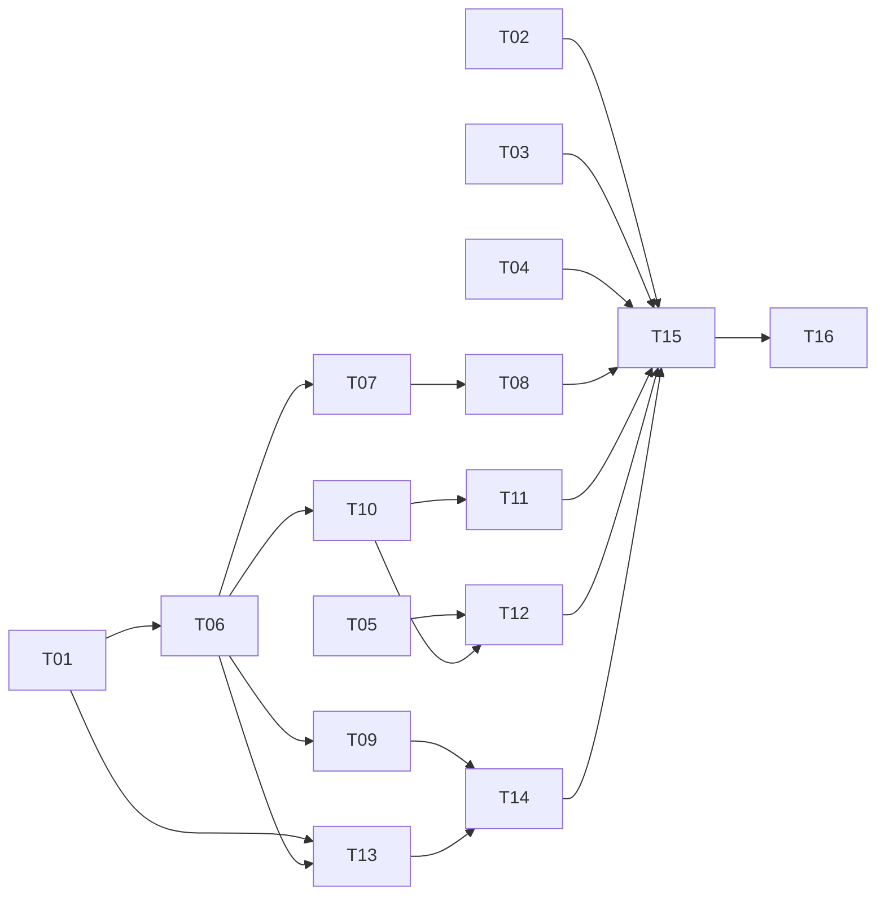

# Plan: v0.2

Drafted 2026-11-28, after v0.1.0. The theme is **several models, in the background**. Like
docs/plan-v0.1.md, it's written so that Claude Code, or OpenCode on Ivan's local model, can pick up
one task at a time and finish it without asking.

## How to work from this file (agents: read this first)

The same rules as docs/plan-v0.1.md:

1. Read `AGENTS.md`, then this whole file once. The contracts below are shared by every task.
2. Take the **first task in Progress that isn't ticked and whose dependencies are ticked.** One task
   = one branch (named in the task) = one PR into `main`.
3. Build exactly what the task says. If something belongs to a later task or version, leave it. If
   the spec is wrong or unclear, fix this file in the same PR and say so in the PR description.
4. A task is done when its acceptance commands pass, on Linux and Windows CI. Tick it in Progress in
   the same PR. Who merges follows the merge policy in `AGENTS.md`.
5. Tasks marked **explain** are the heart of the harness. Ivan wants to learn them, so explain each
   piece as it goes in: what it does, why it's there, and the Rust idiom used. Briefly.
6. **Who:** *any* is mechanical and fully specified, fine for a local model; *frontier* needs
   judgment.

## Progress

- [x] T01 Roles and kinds on the order
- [ ] T02 Token budget · explain
- [ ] T03 Thinking switch per role
- [ ] T04 Shrink old tool arguments · explain
- [ ] T05 Secret files guard · explain
- [ ] T06 Job lifecycle: `queued`, `ork cancel`, one run path · explain
- [ ] T07 Background jobs: `ork run --detach` and the worker · explain
- [ ] T08 `ork watch` and `ork wait`
- [ ] T09 A per-server queue · explain
- [ ] T10 Start from the working tree; apply modes · explain
- [ ] T11 Stacked orders (`--base JOB`) and overlap warnings
- [ ] T12 Worktree setup: links and setup commands
- [ ] T13 Scoreboard v1: `ork stats`
- [ ] T14 The TUI for background jobs
- [ ] T15 Guide, skill, README, decisions
- [ ] T16 Dogfood and release v0.2.0



T02–T05 touch different files and can be built alongside T01 and each other. T07 and T09 can go in
parallel after T06.

## What v0.2 is

The chief hands off several orders at once. Each order:
- runs in its own background `ork` process;
- runs on the role it asks for (any server in `roles`);
- waits its turn when its server is full, across every repo on the machine;
- can start from the uncommitted working tree, or from another job's work;
- and lands back cleanly.

Every job adds to a scoreboard: which model passes which kind of order.

**v0.2 is done when:**
1. Every task is ticked and CI is green on Linux and Windows.
2. The v0.2.0 GitHub release has `ork` binaries for Linux and Windows.
3. On the GPU box with `max_concurrent` set: three detached orders queue and all finish; a grunt job
   and an OpenRouter mercenary job run at the same time; `ork stats` shows both models.
4. From Claude Code on Windows, `ork run --detach --json` returns at once and the job outlives the
   Bash call.
5. An order from a dirty working tree passes and applies as uncommitted changes, with the
   uncommitted work intact.
6. Claude Code, given only the skill, delegates two orders in the background, keeps working, waits,
   and applies them.

## Versions

| Version | What |
|---|---|
| v0.1 | released 2026-11-28: one blocking run at a time |
| **v0.2** | background jobs (`--detach`, `watch`, `wait`, `cancel`), a role per order, a per-server queue, stacked orders, start from the working tree, the scoreboard, token budget, thinking switch, worktree setup and the secret guard, shrinking old tool arguments |
| v0.3 | `ork mcp` (thin adapters: `ork_delegate` = `run --detach`, `ork_wait` = `wait --timeout`), MCP Tasks, `ork init` writing delegation rules and MCP registration, the escalation ladder, the eval |
| later | the web UI (`ork serve`), bubblewrap, routing suggestions, plans, verifiers and the merge queue (docs/swarm.md) |

## Not in v0.2

- MCP; the web UI; any daemon.
- Automatic escalation, routing suggestions, automatic routing.
- Plans, verifiers, the merge queue.
- Queueing `ork ask` (one request; llama-server queues it itself). A queue shared between machines.
  Per-request slots.
- `/run` in the TUI (possible on top of `--detach`, later).
- `max_cost`, `--baseline`, `ork gc`, `ork models --set`.

## Decisions made for v0.2 (also in docs/decisions.md)

- **No daemon.** A background job is its own `ork` process (`ork __work JOB`), cut off from the
  terminal that started it. The job files stay the only shared state.
- **Cancel is a file.** `ork cancel` writes `.ork/jobs/<id>/cancel`, and the job checks for it every
  second. Separate processes share files, not memory.
- **The queue is machine-wide, per user, keyed by the server's URL.**
  - A slot is a lock on a file (std file locks; the OS frees them when the holder dies).
  - Waiting jobs take slots in the order of their ticket files (FIFO).
  - A job holds its slot for its whole run, not per request: llama-server keeps each conversation's
    prompt cache (the KV cache) in a slot, and more conversations than slots means re-reading the
    whole prompt every turn.
  - A local server without `max_concurrent` gets 1 slot; a cloud server gets no limit.
- **Where a job starts.** Auto: from the working tree when it has uncommitted changes, else from
  HEAD (Ivan, 2026-11-28). `--base head` keeps v0.1's behaviour; `--base JOB` stacks on another job.
- **How a job lands.** `ork apply` lands a job the way it started: from a commit → as a commit
  (merge or squash), now also onto a dirty checkout when the files don't overlap; from the working
  tree → as uncommitted changes in your working tree.
- **One new status: `queued`.** A cancelled job is `error` with reason `cancelled`, as Ctrl+C
  already gives in v0.1.
- **`kind` is a fixed set of seven** (`test`, `fix`, `feature`, `refactor`, `docs`, `chore`,
  `investigate`). A role is any name in `roles`; goblin, grunt and mercenary are a convention.
- **Thinking:** `thinking: true|false` per role, plus `extra_body` for anything else.
- **Secret files:** a repo's `ork.json` can only add to the list; only the user file can make
  exceptions.
- **Links in a job's worktree:** directories are linked (a symlink; a junction on Windows, through
  the `junction` crate, no shell), files are copied. Links are removed before any
  `git worktree remove`.
- **Windows handle inheritance** (Ivan, 2026-11-28): std passes `bInheritHandles=TRUE` and
  `inherit_handles` is unstable (rust#146407), so the worker would inherit `--detach`'s stdout pipe
  and an agent's shell tool could wait on it until the job ends. If T07's test shows this, the fix is
  **one reviewed Windows-only `unsafe` module** that clears `HANDLE_FLAG_INHERIT` on ork's own
  stdin, stdout and stderr before the spawn: `[lints.rust] unsafe_code` goes from `forbid` to
  `deny`, with `#[allow(unsafe_code)]` on that module only.

## Ground rules (additions to v0.1's)

- **No daemon, no `unsafe`**, except T07's one module if its test calls for it (above).
- **One new crate:** `junction`, Windows-only, in T12. File locks come from std (`File::lock` /
  `try_lock`, stable since 1.89; the pin is 1.99.1); detaching uses process-wrap (already a
  dependency: `ProcessSession`, `CreationFlags`).
- **New test hooks:**
  - `ORK_EXE`: the binary the worker runs. Tests set `env!("CARGO_BIN_EXE_ork")`.
  - `ORK_STATE_DIR`: the machine-wide state directory.
  - `Workspace` sets both. Tests that start a worker wait for its job to end, or cancel it, before
    they return.
- **Timing in tests:** poll against a deadline (a `wait_until` helper); never a fixed sleep for
  correctness. The fake server's `delay` step is the only deliberately slow thing.
- **Hidden commands** are named `__…`, hidden from help, and skipped by the guide sync test (filter
  `is_hide_set()` in tests/it/guide.rs).
- Every new status, event, flag and field goes into docs/cli.md in the same PR.

## Layout (new and changed)

```
src/work.rs                 run_job: one job's run, wherever it runs (foreground or worker): the ticker
                            (heartbeat + cancel), setup, slot, RunService, the result line (T06)
src/queue.rs                the state dir, server keys, tickets, slots (T09)
src/worktree.rs             a job's worktree: prepare (links, setup) and remove (links first) (T12)
src/secrets.rs              the secret-file matcher (T05)
src/process/detach.rs       starting the worker so it outlives the command (T07)
src/cli/commands/work.rs    the hidden `ork __work JOB` (T07)
src/cli/commands/follow.rs  `ork watch`, `ork wait` (T08)
src/cli/commands/stats.rs   `ork stats` (T13)
tests/it/                   background.rs, queue.rs, snapshot.rs, stacked.rs, setup.rs (new)
tests/it/support/           fake_server: Script::delay, Script::forever; workspace: ORK_EXE, ORK_STATE_DIR
src/bin/ork-testtool.rs     + `lock FILE SECONDS` (T09)
```

## Contracts shared by all tasks

```rust
// orders.rs
pub enum JobStatus { Queued, Running, Passed, FailedChecks, GaveUp, Error, Applied, Discarded }   // + Queued (T06)

pub struct Order {               // v0.1 fields, plus:
    pub role: Option<String>,    // T01: a name in `roles`; None → "grunt"
    pub kind: Option<String>,    // T01: one of KINDS; None → "investigate" when readonly, else unset
    pub base: Option<String>,    // T10/T11: "head" | "worktree" | a job id; None → auto
    pub max_tokens: Option<u64>, // T02: the job's budget, tokens in + out over all calls; None → defaults.max_tokens
}
pub const KINDS: [&str; 7] = ["test", "fix", "feature", "refactor", "docs", "chore", "investigate"];

pub struct Report {              // v0.1 fields, plus:
    #[serde(default)] pub role: String,  // T01 ("" in v0.1 reports = grunt)
    pub cost: Option<f64>,       // T13: US dollars, when the server reported it
}                                // duration_s now runs from started_at, not created_at (T06)

// jobs.rs
pub struct JobState {            // v0.1 fields, plus (all Option, left out when None):
    pub role: Option<String>, pub model: Option<String>, pub server: Option<String>,   // T01, resolved at create
    pub started_at: Option<DateTime<Utc>>,   // T06: when it left the queue
    pub base: Option<Base>,                  // T10: None (v0.1 jobs) = head
    pub base_job: Option<String>,            // T11
}
#[serde(rename_all = "snake_case")] pub enum Base { Head, Worktree, Job }

// config.rs
pub struct ServerConfig  { pub url: String, pub key_env: Option<String>, pub max_concurrent: Option<u32> }   // T09
pub struct RoleConfig    { /* v0.1 */ pub thinking: Option<bool>, pub extra_body: Option<Value> }            // T03
pub struct DefaultsConfig{ /* v0.1 */ pub max_tokens: Option<u64> }                                          // T02
pub struct SecretsConfig { pub deny: Vec<String>, pub allow: Vec<String> }   // T05; allow only from the user file
pub struct WorktreeConfig{ pub link: Vec<String>, pub setup: Vec<String> }   // T12
// OrkConfig gains `secrets` and `worktree`.

// events.rs
Start  { /* v0.1 */ base: Option<String> }                     // T10: "head" | "worktree" | the parent job's id
Queued { server: String, ahead: u32, max: u32 }                // T09: waiting for a slot; again when `ahead` changes
Slot   { server: String, waited_s: f64 }                       // T09: got one, after waiting
Setup  { cmd: String, exit: i32, seconds: f64, tail: String }  // T12
// new warning codes: token_budget (T02), allow_ignored (T05), worker_in_job (T07),
//                    scope_overlap, base_not_passed (T11), link_skipped (T12)
```

**Statuses.**
- `queued`: the job exists and its worktree is made, but it hasn't started: its worker is starting,
  its setup is running, or its server has no free slot. Exit code 0, like `running`.
- A `queued` or `running` job whose heartbeat has been quiet for 90 s reads as `error`,
  `ork stopped …` (as in v0.1), pointing at `worker.log` when there is one.
- Exit codes are otherwise unchanged.

**New job files:**

| File | What |
|---|---|
| `worker.log` | the worker's stdout and stderr (T07) |
| `cancel` | a request to stop, from `ork cancel` (T06) |
| `lock` | locked by the process running the job, for its whole run (T07) |
| `links.json` | the links and copies made in the worktree (T12) |
| `apply.patch` | what a patch-mode apply laid onto the working tree (T10) |

**The state dir** (T09): `ORK_STATE_DIR`, else `%LOCALAPPDATA%\orkestr8r`, else
`$XDG_STATE_HOME/orkestr8r`, else `~/.local/state/orkestr8r`.
```
queue/v1/<server key>/slot-<i>                    locked by the process running a job on that server
queue/v1/<server key>/wait/<ns>-<repo key>-<job>  locked by a job waiting for a slot
repos.txt                                         repos that ran jobs (ork stats --all, T13)
```

**Commands** (for the docs/cli.md block):
```
ork run [ORDER.json | -] … [--role NAME] [--kind KIND] [--base head|worktree|JOB] [--max-tokens N] [--detach]
ork watch JOB                                      follow a job's events live, to its result
ork wait JOB… [--any] [--timeout SECONDS]          block until the job(s) end; the same result as ork run
ork cancel JOB                                     stop a queued or running job (error, reason cancelled)
ork stats [--by model|role] [--kind KIND] [--all]  the scoreboard
ork apply JOB [--squash | --patch] [--force]
ork ask "QUESTION" --path FILE… [--role NAME]
ork doctor [--role NAME]
ork models                                         roles and servers: place, max_concurrent, thinking
```

**Apply modes** (T10, T11):

| The job started from | `ork apply` | `--squash` | `--patch` |
|---|---|---|---|
| HEAD | a merge commit (v0.1) | one commit (v0.1) | its changes in your working tree, uncommitted |
| another job | the same, once that job is applied | same | same |
| your working tree | its changes in your working tree, uncommitted | refused | same as plain |

`result.data` for apply: `{job, mode: "merge"|"squash"|"patch", branch, commit?, squash, files}`.
For patch mode, `commit` is the job's own tip, recoverable until git's garbage collection.

---

## T01 · Roles and kinds on the order

**Branch** `feat/roles` · **Depends on** — · **Who** any

**Files:** `src/orders.rs`, `src/jobs.rs`, `src/runs.rs`, `src/cli/commands/{run,ask,doctor,models}.rs`,
`docs/cli.md`, `src/cli/guide.md`.

**Details**
- `--role NAME` and order `role`. `ModelClient::for_role(config, order.role or "grunt", env)`
  replaces the hard-coded `"grunt"` in run.rs, ask.rs and doctor.rs.
  - Config validation still requires `roles.grunt`: it's the default.
  - An unknown role is an order problem: `role: "merc" isn't in roles (goblin, grunt)`.
- `--kind KIND` and order `kind`, validated against `KINDS`; an unknown kind lists the set. A
  readonly order without a kind gets `investigate`. The kind isn't sent to the model.
- `JobStore::create` records the resolved `role`, `model` and `server` in `JobState`; `start` carries
  the role; the report carries `role`.
- `ork doctor --role NAME` (default `grunt`) checks that role's server and tool calling. `ork models`
  marks `grunt` as the default.
- Goblin, grunt and mercenary appear only in the docs, as suggested names.

**Tests** (`run.rs`, `ask.rs`, `doctor.rs`), with two fake servers (grunt → A, goblin → B):
- `run --role goblin` sends every request to B and none to A; `start`, `JobState.role` and
  `report.role` say goblin;
- an unknown role exits 1 listing the roles, and no job is created;
- `--kind` is stored; an unknown kind is a problem listing the set; readonly defaults to
  `investigate`;
- `ask --role goblin` and `doctor --role goblin` go to B.

**Acceptance:** `cargo test --all-features --test it -- run:: ask:: doctor:: guide::`

## T02 · Token budget · explain

**Branch** `feat/token-budget` · **Depends on** — · **Who** any

**Files:** `src/config.rs`, `src/orders.rs`, `src/grunt/mod.rs`, `src/cli/commands/run.rs`, docs.

**Details**
- `defaults.max_tokens` (absent = no budget; > 0 when set), order `max_tokens`, `--max-tokens N`.
  In the code it's `LoopSettings.token_budget`: `LoopSettings.max_tokens` already means the
  per-reply output cap.
- The budget counts tokens in + out over every call of the job (what `report.tokens` adds up),
  repair turns included.
- **The stop:** after a reply, if the total is at or over the budget, the loop gives up with
  `max_tokens`. The reply's tool calls aren't run; the work so far is committed as usual.
- **The nudge:** the first time the total reaches 80%, append a user message after the turn's
  results: `You have used 80% of this job's token budget. Finish now: call finish with what you
  have, or with the question that blocks you.` Emit a `token_budget` warning.
- No default value: what real jobs spend isn't known until the scoreboard shows it.

**Tests** (`grunt.rs`), with the script's fixed usage of 100 in / 20 out per reply:
- budget 300: gives up after the 3rd reply, `gave_up`, reason `max_tokens`, exit 4;
- one nudge, at ≥ 240;
- the order's budget overrides the default; no budget changes nothing.

**Acceptance:** `cargo test --all-features --test it -- grunt:: run::`

**Learn:** a budget is a guard like v0.1's (a nudge, then the stop). Prompt tokens dominate because
every request resends the whole history.

## T03 · Thinking switch per role

**Branch** `feat/thinking` · **Depends on** — · **Who** any

**Files:** `src/config.rs`, `src/model/mod.rs`, `src/cli/commands/models.rs`, docs.

**Details**
- `roles.<name>.thinking: true|false`. Absent: nothing is sent, the server's default applies. The
  wire form depends on the server's host:

  | Server | `false` | `true` |
  |---|---|---|
  | host ends in `openrouter.ai` | `"reasoning": {"enabled": false}` | `"reasoning": {"enabled": true}` |
  | anything else (llama.cpp with `--jinja`, llama-swap, vLLM, SGLang) | `"chat_template_kwargs": {"enable_thinking": false}` | `… true` |

- `roles.<name>.extra_body`: an object deep-merged into the request body last (`config::merge`).
  Validation refuses the keys `model`, `messages`, `tools`, `tool_choice` and `stream`. It covers
  templates and servers that spell thinking differently (Ollama, gpt-oss's `reasoning_effort`).
- `ork models` shows `thinking on/off`.
- Check OpenRouter's current docs when building this: some models can only hide their reasoning
  (`exclude`), not skip it.

**Tests** (`model.rs`, `config.rs`):
- the request body for a 127.0.0.1 client and for an `https://openrouter.ai/api/v1` client (built,
  not sent);
- `extra_body` merges and wins; reserved keys are refused;
- a real run with the role puts `chat_template_kwargs` in the fake server's recorded body.

**Acceptance:** `cargo test --all-features --test it -- model:: config::`

## T04 · Shrink old tool arguments · explain

**Branch** `feat/shrink-args` · **Depends on** — · **Who** frontier

**Files:** `src/grunt/context.rs`, `src/grunt/mod.rs` (the warning text),
`src/tools/{write_file,edit_file}.rs`.

**Details**
- When the prompt passes 75% of the window, `ContextKeeper::shrink` walks the messages oldest
  first, stops under 60%, and makes two kinds of stub:
  - a tool result → v0.1's stub;
  - an assistant message's tool calls → every string argument over 200 characters becomes
    `"[N chars removed from the history to save context]"`. The arguments are parsed as JSON and
    re-serialized, so they stay valid. Arguments that don't parse and are over 200 characters become
    `{"removed":"N chars"}`.
- Never touched: the system message and the first user message; the newest 4 tool results and the
  newest 4 assistant messages with tool calls; message order and call ids. Nothing is removed, only
  rewritten, so each call stays paired with its result.
- The warning `context_stubbed` says `N outputs and M arguments`.
- **A guard against imitation:** a `write_file` `content` or `edit_file` `new` containing
  `removed from the history to save context` is refused: `that's a placeholder from your history,
  not the file's content`.

**Tests** (`grunt.rs`, `tools.rs`):
- every assistant `tool_calls[].function.arguments` still parses after shrinking;
- ids are unchanged and each is paired with its result; the protected messages are untouched;
- it stops at 60%; the placeholder is refused; v0.1's stubbing tests still pass.

**Acceptance:** `cargo test --all-features --test it -- grunt:: tools::`

**Learn:** a written file lives twice, in the call's arguments and on disk, and is resent every
turn; why calls and results must stay paired (servers reject a tool message without its call);
in-context imitation: the model copies what it sees in its own history.

## T05 · Secret files guard · explain

**Branch** `feat/secret-guard` · **Depends on** — · **Who** frontier

**Files:** `src/secrets.rs`, `src/config.rs`, `src/tools/{guard,grep,mod}.rs`, `src/orders.rs`,
`src/cli/commands/ask.rs`, docs and SECURITY.md.

**Details**
- **The built-in list:** `.env` and `.env.*` (except `.env.example`, `.env.sample`,
  `.env.template`); `*.pem`, `*.key`, `*.p12`, `*.pfx`; `id_rsa`, `id_dsa`, `id_ecdsa`, `id_ed25519`
  (not `.pub`); `.npmrc`, `.pypirc`, `.netrc`, `.pgpass`, `.git-credentials`, `*.tfvars`. A pattern
  without `/` matches at any depth; matching is case-insensitive on Windows.
- **Trust:** `secrets.deny` adds patterns; `load` takes the union over the files (arrays replace
  each other in the merge). `secrets.allow` (exceptions) counts only from the user file or
  `ORK_CONFIG`; a repo's `allow` is dropped with the warning `allow_ignored`.
- **Where it applies:**
  - `PathGuard::resolve` refuses reads and writes whose real path matches:
    `refused: .env is a secret file: ork doesn't show secrets to the model`;
  - `list_dir` still shows the names;
  - `grep` excludes them (`rg -g '!<p>'`, `git grep ':(exclude,glob)<p>'`) and filters the result
    lines again;
  - order `paths` and `ask --path` refuse them before any request.
- **Not covered:** the `run` tool and the checks. They run commands, and commands can read anything.
  The docs say so.

**Tests** (`tools.rs`, `config.rs`, `ask.rs`, `run.rs`):
- `.env` refused; `.env.example` allowed; `config/.env.local` refused; a link to `.env` refused;
- grep excludes them (the `git grep` path, and `rg` when it's on PATH); `write_file .env` refused;
- a repo's `allow` is ignored with the warning; the user file's `allow` works;
- an order path `.env` exits 1; `ask --path .env` is refused.

**Acceptance:** `cargo test --all-features --test it -- tools:: config:: ask:: run::`

**Learn:** the threat is secrets leaving the machine (a cloud mercenary) and landing in transcripts.
That's why a repo can only tighten the list.

## T06 · Job lifecycle: `queued`, `ork cancel`, one run path · explain

**Branch** `feat/job-lifecycle` · **Depends on** T01 · **Who** frontier

**Files:** `src/orders.rs`, `src/jobs.rs`, `src/work.rs` (new), `src/runs.rs`,
`src/cli/commands/{run,jobs}.rs`, `src/cli/mod.rs`, `src/tui/{app,ui}.rs` (only what the compiler
needs: a `QUEUED` pill), `tests/it/support/fake_server.rs` (`Script::delay`), docs.

**Details**
- **States:** `queued → running → passed | failed_checks | gave_up | error → applied | discarded`.
  - `JobStore::create` writes `queued`; `JobStore::start(id)` writes `running` and `started_at`.
  - `effective()` treats `queued` like `running`.
  - Job ids are claimed with `create_dir`, not `create_dir_all`: several processes now create jobs
    at once.
- **`work::run_job(store, id, config, env, events, cancel) -> Result<Report>`** is the one run path:
  foreground `ork run` calls it, and so does T07's worker.
  1. The job's token is `cancel.child_token()`, so Ctrl+C on a foreground run still reaches it.
  2. A ticker (moved from run.rs, `AbortOnDrop`) runs every 1 s: if `.ork/jobs/<id>/cancel` exists,
     it cancels the token; every 10th tick it writes the heartbeat.
  3. (Setup comes here in T12, the slot in T09.)
  4. `start()`, then `RunService`, then the `result` line appended to `events.jsonl`, then the cancel
     marker removed.
  - An error before `RunService` writes `error` and a `result` line, so watchers see the end.
- **`run.rs`** becomes submit + `run_job`. Submit is: validate, base, create, worktree, `start`
  event.
- **`report.duration_s`** runs from `started_at`: time waiting in the queue isn't counted.
- **`ork cancel JOB`:**
  - a queued or running job: write `cancel`, then poll every 200 ms, up to 30 s, for a final status.
    The result is `ok`, `data {job, state}`; if it doesn't stop in time, an error naming the
    heartbeat;
  - an already finished job: `ok`, with a note;
  - a stopped job (`ork stopped`): write that `error` for real, so `discard` can clean it up.
- **`ork discard`** of a queued or running job cancels it first.

**Tests** (`run.rs`, `jobs.rs`, `background.rs`), with a delayed fake reply and the run in a tokio
task:
- `cancel` → the run exits 1, `error`, reason `cancelled`, the commit and worktree kept, a report
  written;
- `cancel` of a finished job is ok; `discard` of a running job;
- a stale `queued` job reads `ork stopped`;
- `started_at ≥ created_at`, and the duration doesn't count the wait.

**Acceptance:** `cargo test --all-features --test it -- run:: jobs:: background::`

**Learn:** the job as a state machine; why cancel is a file; child tokens; one ticker doing two jobs.

## T07 · Background jobs: `ork run --detach` and the worker · explain

**Branch** `feat/detach` · **Depends on** T06 · **Who** frontier

**Files:** `src/process/detach.rs`, `src/cli/commands/{work,run}.rs`, `src/cli/mod.rs`,
`src/main.rs`, `tests/it/support/workspace.rs`, `tests/it/guide.rs`, `tests/it/background.rs`, docs.

**Details**
- **`--detach`:** the parent submits as in T06, then starts the worker:
  - the program: `ORK_EXE`, else `current_exe()`, with the arguments `__work <id>`;
  - cwd: the repo root;
  - env: exactly `ctx.env` (`env_clear` + `envs`), with `ORK_CONFIG` made absolute;
  - stdin null; stdout and stderr to `worker.log`, which the parent creates.
- **Unix:** process-wrap `ProcessSession` (setsid). No controlling terminal, so closing the terminal
  sends no SIGHUP, and a kill of the caller's process group misses it.
- **Windows:** `CreationFlags(CREATE_NO_WINDOW | CREATE_NEW_PROCESS_GROUP | CREATE_BREAKAWAY_FROM_JOB)`.
  - If CreateProcess fails with error 5, the caller's job object doesn't allow breakaway: retry
    without that flag and warn `worker_in_job`.
  - Not `DETACHED_PROCESS`: a worker with no console makes every git and cargo child it starts open
    a console window.
- No `KillOnDrop` and no `JobObject`: the child handle is dropped; nothing waits for it.
- If the worker can't be started, the job is `error`, `couldn't start the worker: …`, exit 1.
- **The parent then prints** `result` with status `queued`, exit 0, `job`, `data.state`. For people:
  `k7f2 queued in the background · ork watch k7f2 · ork wait k7f2 · ork cancel k7f2`.
- **`ork __work JOB`** (hidden):
  - finds the repo from its cwd and loads the raw state, which must be `queued`;
  - takes `lock` with `try_lock`, held for its whole run; if either check fails, it exits and
    touches nothing;
  - loads the order and the config, sends events to `FileSink` only, runs `run_job`, and exits with
    `ork run`'s code.
- **main.rs:** on Unix, SIGTERM also cancels the token, so `kill` ends a job as `cancelled`.
- **Ctrl+C:** a foreground `run` cancels its job (v0.1). After `--detach` returns, the terminal can't
  reach the worker; only `ork cancel` stops it.
- **The Windows handle check:** if `detach_closes_its_stdout_at_once` fails on Windows, add
  `src/process/no_inherit.rs` (Windows-only, the one `#[allow(unsafe_code)]` module): before the
  spawn, `SetHandleInformation(h, HANDLE_FLAG_INHERIT, 0)` on ork's own stdin, stdout and stderr
  (`windows-sys`, `Win32_Foundation` + `Win32_System_Console`), with a comment saying why. Change
  `unsafe_code` to `deny` in Cargo.toml and say so in the PR.

**Tests** (`background.rs`), with the real binary through `ORK_EXE` and the fake server in the test
process:
- detach returns in under 5 s with `start` then `result:queued`; the job then passes;
- `events.jsonl` runs from `start` to exactly one `result`; `worker.log` exists;
- a bad order exits 1, with no job and no worker;
- `__work` isn't in `--help`; `__work` on a passed job exits without touching it; two `__work` for
  one job → only one runs;
- a relative `ORK_CONFIG` works;
- **`detach_closes_its_stdout_at_once`**: spawn the real binary with stdout piped and the fake reply
  delayed 20 s; EOF must come within 5 s.

**Acceptance:** `cargo test --all-features --test it -- background:: guide::`

**Learn:** sessions, process groups, consoles and job objects; why the output goes to a file; why
there's no daemon (each worker is a one-job daemon that exits).

## T08 · `ork watch` and `ork wait`

**Branch** `feat/watch-wait` · **Depends on** T07 · **Who** any

**Files:** `src/cli/commands/{follow,jobs}.rs` (a `job_result` shared with `status`),
`src/cli/mod.rs`, docs (the MCP table: `ork_wait` = `wait --timeout`), `src/cli/guide.md`.

**Details**
- **`ork watch JOB`:**
  - reads `events.jsonl` from the start, then follows it: polls every 200 ms, keeps its read offset,
    holds back a partial last line;
  - with `--json` the job's lines pass through verbatim (their own `ts`); without it, they go through
    `HumanSink`;
  - the job's own `result` line is skipped. Once the job's effective status is final and the file is
    read to its end, watch ends with `job_result`: the job's status, report and `ork run`'s exit
    code;
  - Ctrl+C stops only the watching: the current status, exit 0, and a note
    `still running: ork cancel k7f2 stops it`.
- **`ork wait JOB… [--any] [--timeout S]`:** polls the states every 500 ms.
  - One job: exactly `ork status`'s result once it ends.
  - Several (all): `status: ok`; exit 1 if any job is `error`, else 4 if any failed or gave up, else
    0; `data.jobs: [{job, status, exit_code, report}]`.
  - `--any`: the first job to end gives the top-level result, with `data.waiting: [ids]`.
  - A timeout: the current statuses, exit 0, `data.timed_out: true`. No timeout: wait for ever.

**Tests** (`background.rs`):
- watch on a detached job gives the same events, in order, as `events.jsonl`, plus exactly one
  result;
- watch on a finished job prints the whole log and ends at once;
- wait for a passing job → exit 0 with the report; a failing job → 4; `--any` with two jobs;
  `--timeout` on a delayed job → `running`, `timed_out`.

**Acceptance:** `cargo test --all-features --test it -- background:: guide::`

## T09 · A per-server queue · explain

**Branch** `feat/queue` · **Depends on** T06 · **Who** frontier

**Files:** `src/queue.rs`, `src/config.rs`, `src/work.rs`, `src/events.rs`,
`src/cli/commands/models.rs`, `src/bin/ork-testtool.rs` (`lock FILE SECONDS`), `tests/it/queue.rs`,
`tests/it/support/fake_server.rs` (`Script::forever`), docs.

**Details**
- **The limit:** `servers.<n>.max_concurrent` (≥ 1). Absent: 1 for a local server
  (`Place::of_url`), no limit for a cloud one. It counts jobs per URL, whatever model they use: on
  llama-swap, jobs on different models swap the loaded model on every request, so keep it at 1 there
  unless the models share a group.
- **Keys:** server key = the URL lowercased, without a trailing `/`, every character outside
  `[a-z0-9.-]` → `_`, cut at 80 characters plus an FNV-1a hash suffix when cut; repo key = 8 hex
  digits of FNV-1a over the canonical repo root.
- **`Queue::acquire(max, ticket, cancel, on_wait) -> Slot`** (in `run_job`, after setup, before
  `start()`):
  1. Create `wait/<ns:020>-<repo>-<job>` with `create_new`, then `lock()` it. The ticket stays
     locked while the job waits.
  2. Every 500 ms (a field; tests use 50 ms):
     - count the live tickets ahead of mine;
     - a ticket older than 5 s that I can `try_lock` belongs to a dead waiter: delete it;
     - with no live ticket ahead, `try_lock` `slot-0`…`slot-(max-1)`; on success delete my ticket and
       return `Slot(File)`, which frees the slot when dropped;
     - otherwise emit `queued {server, ahead, max}` when `ahead` changed, and wait.
  3. Cancel deletes my ticket and gives `error`, `cancelled`.
  4. After waiting, emit `slot {server, waited_s}`.
- **Why it's safe and fair:** the locks make it safe (the OS frees them when a process dies: no
  stale-slot timeout, clock jumps don't matter); the tickets make it fair (only the first in line
  tries for a slot: FIFO with no shared counter). std opens files non-inheritable, so a `cargo test`
  the job starts never holds a slot.
- **Display:** `ork status` of a queued job shows its last `queued` event
  (`queued for box (max 1): 2 ahead`). `ork models` adds
  `servers: [{name, url, place, max_concurrent, default}]`.
- `Workspace` sets `ORK_STATE_DIR` to a temp directory.

**Tests** (`queue.rs`):
- max 1: the second acquire waits until the first slot drops;
- three waiters are served in ticket order;
- a holder killed while holding (`ork-testtool lock`) frees its slot at once;
- a stale ticket is cleaned up; cancel while waiting removes the ticket;
- two Workspaces on one URL share the queue;
- end to end: two runs at max 1 with delayed replies → the second shows `queued` then `slot`, and
  the script ran in order, not interleaved.

**Acceptance:** `cargo test --all-features --test it -- queue:: background::`

**Learn:** a semaphore made of files; locks for safety, tickets for fairness; why slots are per job
(the KV cache); why the queue is machine-wide (the GPU box serves every repo).

## T10 · Start from the working tree; apply modes · explain

**Branch** `feat/snapshot` · **Depends on** T06 · **Who** frontier

**Files:** `src/git.rs`, `src/cli/commands/{run,jobs}.rs`, `src/orders.rs`, `src/jobs.rs` (the id
generator skips `head`), `src/events.rs`, `tests/it/snapshot.rs`; update
`jobs::apply_refuses_a_dirty_checkout` and `run::a_dirty_checkout_is_a_warning_after_start`; docs.

**Details**
- **The base:** `--base` or order `base` = `head`, `worktree`, or a job id (T11). Auto = `worktree`
  when `is_clean` is false, else `head`. `start.base` and the human line (`from your working tree`)
  say which. `dirty_checkout` stays as a warning for `--base head`.
- **The snapshot** (the user's index and files are never written):
  1. Size guard: untracked files (`ls-files --others --exclude-standard -z`) over 1,000 files or
     100 MB are refused, naming the biggest, with the hint `.gitignore` or `--base head`.
  2. `tmp = .ork/snapshot-<ns>.index`: copy the file at `git rev-parse --git-path index` (keeping
     git's file-status cache, so nothing is re-hashed); without an index,
     `GIT_INDEX_FILE=tmp git read-tree HEAD`.
  3. `GIT_INDEX_FILE=tmp git add -A`: modified, deleted, staged and untracked files; respects
     `.gitignore` and `.ork/`.
  4. `tree = GIT_INDEX_FILE=tmp git write-tree`; delete `tmp`, also on error.
  5. If `tree == HEAD^{tree}`, the base is HEAD.
  6. Else `base = git commit-tree <tree> -p HEAD -m "ork: snapshot of the working tree"`, with ork's
     identity.
  - `Git` gains `run_env` (for `GIT_INDEX_FILE`), `status_paths`
    (`status --porcelain=v1 -z --no-renames --untracked-files=all`, ignoring `.ork/`),
    `changed_paths` (`diff --name-only -z --no-renames`), `is_ancestor`
    (`merge-base --is-ancestor`), `rev_parse`, `blob_matches` (`hash-object --path` against
    `rev-parse base:path`) and `apply_patch`.
  - Not `git stash create`: it skips untracked files, usually the new code the tests are for.
- **Apply** (the table in Contracts):
  - **Commit modes:** nothing may be staged; no file the job changed may have uncommitted changes
    (refused, naming them; hint `--patch`); if the job's base isn't an ancestor of HEAD (you rebased,
    or its parent was squashed), it's applied as a squash, with a note; then v0.1's `git merge` or
    `--squash`, which works onto a dirty tree because the files don't overlap. A conflict aborts with
    `reset --merge`, which keeps your unstaged changes.
  - **Patch mode:** every file the job changed must be as the job found it (the same blob as in its
    base; deleted files present; added files absent), otherwise refused, naming them; then
    `git diff --binary --full-index --no-renames base tip` → `apply.patch`, and `git apply` (working
    tree only): atomic, leaves the index alone.
  - Then v0.1's cleanup.

**Tests** (`snapshot.rs`, `jobs.rs`, `run.rs`):
- the snapshot has modified, deleted, staged and untracked files, but no ignored files and nothing
  from `.ork/`;
- `.git/index` bytes and `git status --porcelain=v2` are identical before and after;
- a clean tree gives a HEAD base; the job's diff excludes your uncommitted work;
- a patch apply lays on only the job's changes, keeps your uncommitted work, stages nothing;
- a file changed since the job started → refused, nothing touched;
- a HEAD job applies onto a dirty tree as a merge, and your uncommitted work stays uncommitted;
- overlap with dirty files → refused, naming them; staged changes → refused;
- `--squash` on a working-tree job → refused; a rebased base → squash with the note;
- untracked files too big → refused;
- Windows with `core.autocrlf=true`: the patch still applies.

**Acceptance:** `cargo test --all-features --test it -- snapshot:: git:: jobs:: run::`

**Learn:** the index is only a file; a commit is made from a tree; why not stash; merge vs patch;
why "as the job found it" is the safe rule.

## T11 · Stacked orders (`--base JOB`) and overlap warnings

**Branch** `feat/stacked` · **Depends on** T10 · **Who** frontier

**Files:** `src/cli/commands/{run,jobs}.rs`, `src/orders.rs`, `src/jobs.rs`, `tests/it/stacked.rs`,
docs.

**Details**
- **The parent** (`--base JOB`) must exist and not be read-only, still have its branch (not applied
  or discarded), and not be queued or running. If it isn't `passed`, warn `base_not_passed`.
- The child's base is `rev-parse ork/<parent>`, with `base: job`, `base_job: <parent>` in its state.
- A job whose chain of parents leads back to a working-tree job applies as a patch (its base holds
  your uncommitted work).
- **Applying a child:** the parent must be applied first (`apply k7f2 first: c3d4 starts from its
  work`); a discarded parent → refused, with the hint to re-run the order, or `--patch` for the
  child's own changes alone; a squashed parent → T10's ancestor rule makes the child a squash too.
- **Overlap warning at apply** (`scope_overlap`; the apply still goes on), for every other open job
  B: if B has a branch, B's changed files ∩ the applied job's; if B is queued or running, B's
  `write_scope` matched against the applied job's changed files. It names B and the files.
- `ork discard PARENT` warns when children are built on it.

**Tests:** the child sees the parent's changes and its diff is only its own; applying the child first
→ refused; parent then child → both land; a squashed parent → the child is squashed; two passed jobs
touching one file → the warning; a running job's scope → the warning.

**Acceptance:** `cargo test --all-features --test it -- stacked:: jobs::`

## T12 · Worktree setup: links and setup commands

**Branch** `feat/worktree-setup` · **Depends on** T05, T10 · **Who** frontier

**Files:** `src/worktree.rs`, `src/config.rs`, `src/git.rs`, `src/work.rs`, `src/runs.rs` (the
baseline worktree, cleanup), `src/cli/commands/jobs.rs`, `src/events.rs`, `Cargo.toml`
(`[target.'cfg(windows)'.dependencies] junction`), `tests/it/setup.rs`, docs.

**Details**
- **`worktree.link`** entries: relative to the repo, inside it, no `..`; not `.git` or `.ork`; must
  exist in the main checkout. Directories → a symlink on Unix, a junction on Windows
  (`junction::create`); files → copied. A path the worktree already has (a tracked file) is skipped
  with `link_skipped`. Each is recorded in `links.json`.
- **`worktree.setup`** commands: checked against the allow-list, program found on PATH, at submit
  time; run in the worker, in the worktree, before the slot, with `check_timeout_seconds`; each
  emits a `setup` event; a failure makes the job `error`, `setup: npm ci exited 1`, before any model
  request.
- **`worktree::remove`** removes the links first (`remove_file` on a symlink, `remove_dir` on a
  junction, which never follows it), then `git worktree remove --force`. apply, discard, the readonly
  cleanup and the baseline worktree all use it; the baseline worktree gets the links too.
- **`commit_all`** adds with `:(exclude)<link>` pathspecs (a symlink named `node_modules` isn't
  matched by `node_modules/` in `.gitignore`, and a copied `.env` may not be ignored at all), and
  decides there's nothing to commit by `diff --cached --quiet`, not by `status`.
- `.env` may be linked so the checks can read it; T05 still refuses the grunt.

**Tests:** a linked directory resolves in the worktree; **removing the worktree leaves the target's
files in place** (both OSes); a copied file that isn't ignored isn't committed; a link outside the
repo, with `..`, or to `.git` → a config problem; a failing setup → `error` and 0 model requests; a
setup command that isn't allowed → refused at submit.

**Acceptance:** `cargo test --all-features --test it -- setup:: git:: tools::`

## T13 · Scoreboard v1: `ork stats`

**Branch** `feat/scoreboard` · **Depends on** T01, T06 · **Who** any

**Files:** `src/stats.rs` (`Scoreboard::from_jobs`, pure), `src/cli/commands/stats.rs`,
`src/orders.rs` and `src/runs.rs` (`Report.cost`), `src/jobs.rs` (`repos.txt`),
`src/tui/{commands,app}.rs` (`/stats` opens the pager), `tests/it/stats.rs`, docs.

**Details**
- **Rows:** model @ server (`--by role` for roles) × kind, plus an "all kinds" row per model.

  | Column | Counts |
  |---|---|
  | n | jobs whose report status is passed, failed_checks or gave_up |
  | 1st try | passed with 0 repairs ÷ n |
  | passed | passed ÷ n |
  | applied | applied ÷ (applied + discarded), write jobs only; `-` when none decided |
  | avg min | mean `duration_s` ÷ 60 |
  | tokens | mean in + out per job |
  | cost | the sum, when reported (else the job's `call` events) |
  | err | errors, cancels included; not in n: they say more about the server than the model |

- Rates from fewer than 10 jobs are marked `~`, footer `~ fewer than 10 jobs: too few to rank`.
  `data.rows[]` carries the same fields plus `few`.
- The outcome comes from `report.status`, the decision from `state.status`.
- `--all` reads every repo in `repos.txt` (appended once, at job create).

**Tests:** n leaves out running, queued and errored jobs; 1st try vs passed; applied over decided
jobs; `few` under 10; readonly jobs have applied = null; grouping by role vs model; the human table;
the `--json` shape; `/stats` opens the pager.

**Acceptance:** `cargo test --all-features --test it -- stats:: tui:: guide::`

## T14 · The TUI for background jobs

**Branch** `feat/tui-background` · **Depends on** T09, T13 · **Who** frontier

**Files:** `src/tui/{app,ui,commands,theme}.rs`, `tests/it/tui.rs`.

**Details**
- A muted `QUEUED` pill, and `◌ n QUEUED` in the header.
- The selected job shows its last `queued` event: `waiting for a slot on box · 1 ahead`.
- The clock and `JobView::seconds` run from `started_at`.
- `c` and `/cancel [job]` cancel, after a y/n question. `x` on a running job asks
  `cancel and discard?`.
- A working-tree job's `s` (squash) says it applies as a patch.

**Tests:** drawing a queued job; `c` → the question → `y` runs `cancel <id>`; `/cancel`; the clock
from `started_at`; small terminals.

**Acceptance:** `cargo test --all-features --test it -- tui::`

## T15 · Guide, skill, README, decisions

**Branch** `docs/v0.2` · **Depends on** T02–T04, T08, T11, T12, T14 · **Who** frontier

**Files:** `src/cli/guide.md`, `skills/orkestr8r/SKILL.md`, `README.md`,
`docs/{cli,decisions,ideas,vision,iteration-1}.md`, `AGENTS.md` (Status).

**Details**
- **The guide's background flow:** `ork run ORDER --detach --json` → `result.job`; keep working;
  `ork wait JOB --timeout 540 --json` (again while `timed_out`); or run `ork wait` in your shell's
  own background mode if it tells you when commands end.
- Picking a role (from `ork models`), `kind`, `base`, the apply modes, `cancel` and `stats`.
- The skill gets one line about long runs.
- Rewrite docs/cli.md's "In v0.1, `ork run` blocks…" paragraph.
- decisions.md: anything the build changed; ideas.md: mark the shipped items.

**Acceptance:** `cargo test --all-features --test it -- guide:: skill::`

## T16 · Dogfood and release v0.2.0

**Branch** `release/v0.2.0` · **Depends on** T15 · **Who** Ivan + frontier

**Steps** (one at a time; ask before touching the GPU box):
1. Install; `ork --version`.
2. On the box: tokens per second per slot and in total at `--parallel 1/2/4`, with the context
   each grunt needs. Set `max_concurrent` from it.
3. Three detached orders at once: they queue, and all finish.
4. From Claude Code on Windows: `--detach` returns at once, and the job outlives the Bash call.
5. A grunt and a mercenary in parallel; `ork stats`.
6. A test-writing order from uncommitted code; apply as a patch; the uncommitted work is intact.
7. Thinking on vs off on the same order.
8. Log everything in `docs/dogfood/v0.2.md`.
9. Release: version 0.2.0, decisions.md, tag `v0.2.0`.

## Risks

| Risk | What to do |
|---|---|
| **Windows handle inheritance**: the worker inherits the `--detach` parent's stdout pipe, and an agent shell tool that waits for EOF hangs until the job ends | T07's `detach_closes_its_stdout_at_once` shows it; the decided fix is the one reviewed `unsafe` module (Decisions) |
| The caller's job object refuses breakaway, so the worker dies when an IDE or agent closes its job | `worker_in_job` warning, heartbeat → `ork stopped`; measured in T16 |
| `git worktree remove` follows a junction and deletes the real `node_modules` | links removed first (T12), tested on Windows CI |
| Snapshots of large repos are slow, or swallow build output that isn't ignored | the index copy keeps the cache; the untracked size guard; measured |
| `git apply` and CRLF on Windows | the autocrlf test in T10 |
| Head-of-line blocking when repos set different `max_concurrent` for one URL | docs: set it in the user file |
| Default-from-worktree surprises (uncommitted work breaks the checks) | `start.base` and the human line; `failing_before` runs on the snapshot; `--base head` |
| The grunt copies argument stubs into files | the placeholder guard (T04); count the refusals |
| The secret guard is taken for a sandbox | docs: tools only; commands and checks can read anything |
| Thinking parameters differ by server and template | `extra_body`; verify OpenRouter's field when building |
| Flaky timing in CI (slow process start on Windows) | deadlines and polling, generous timeouts |
| Concurrent `git worktree add` from several processes | ids via `create_dir`; retry `worktree add` once on a lock error |

## What to measure

- Tokens per second per slot and in total at `--parallel 1/2/4`: that sets `max_concurrent`.
- Time from `--detach` to the first model call (worker start, setup, slot).
- Snapshot time on a mid-sized web repo.
- Thinking on vs off: turns, minutes, pass rate on the same orders.
- How often the argument shrink fires, and whether the grunt then re-reads files.
- Real tokens per job (from the scoreboard), before suggesting a default `max_tokens`.
- Jobs per (model, kind) cell after dogfooding: how far from n = 10.
